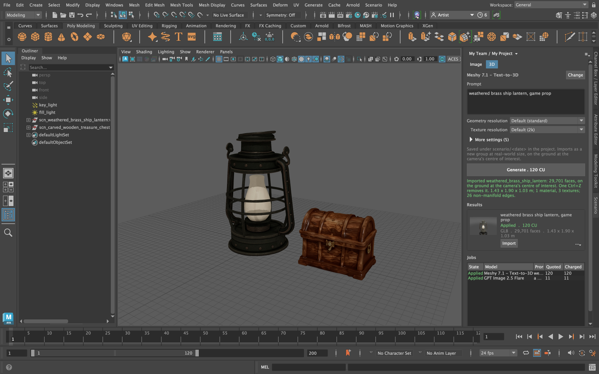
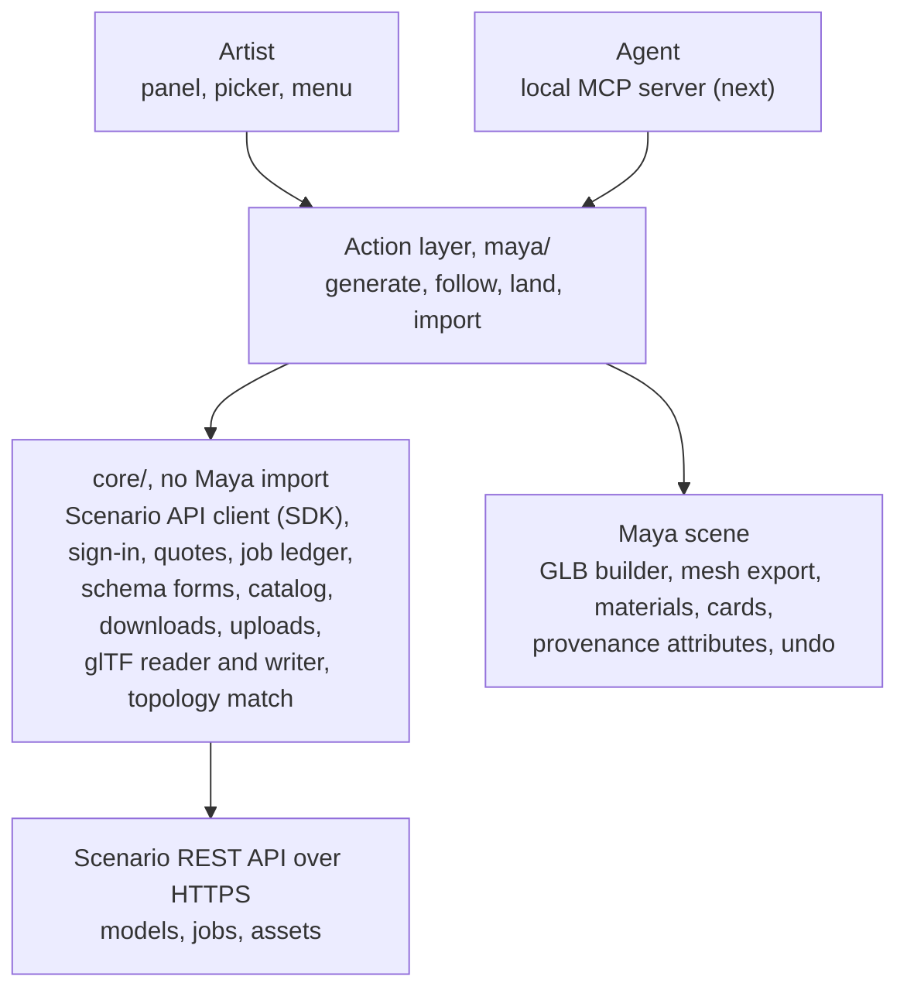

<p align="center">
  <a href="https://www.scenario.com/"></a>
</p>
<h1 align="center">Scenario for Maya</h1>
<p align="center">
  <a href="https://github.com/scenario-labs/maya-plugin/releases"></a>
  <a href="https://github.com/scenario-labs/maya-plugin/actions/workflows/ci.yml"></a>
  <a href="LICENSE"></a>
  
  <a href="https://docs.scenario.com"></a>
  <a href="https://help.scenario.com"></a>
  <a href="https://scorecard.dev/viewer/?uri=github.com/scenario-labs/maya-plugin"></a>
</p>

Make 3D models, mesh edits, motion and images with Scenario's models without
leaving Maya 2025, 2026 or 2027. Give the panel a prompt, an image, views of
an object, a mesh or a character, see the exact price on the button, and the
result lands in the open scene as one undo step.



## What it does

- **3D from a prompt, an image or views of an object.** A model lands on the
  ground in front of the camera at its real size, or over the object its
  views were captured from, with PBR materials and import checks.
- **Edits your meshes.** Remesh, UV unwrap or retexture a mesh of the scene;
  the result comes back fitted over it, or applied onto it after a review.
- **Animates characters.** A prompt makes a character move: the model's own,
  or yours, rigged and animated, landed with its joints, skin and clip.
- **Images in the scene.** As a card, a material or an image plane, and one
  click away from a 3D model.
- **Shows the price first.** The exact price is on the Generate button before
  you click, every request is sent once and recorded on disk, and every
  landing is one Ctrl+Z.

**Status:** early version. Tested on Maya 2027.2 on macOS, in the real Maya
window and headless with `mayapy` (the Multi-view, Edit selection and Motion
modes headless only so far).

| Area | Today | Next |
| --- | --- | --- |
| Sign-in | Browser (OAuth), a code on another device, or an API key; secrets in the system keychain | |
| Panel | Docked beside the Channel Box and restored with the workspace; team and project picker; model picker; job list | Studio window, quick composer over the viewport |
| 3D | Text to 3D (Meshy 7.1, Meshy T2.5, Tripo P2, Rodin Gen-2.5) and image to 3D (Meshy 7.1, Tripo P2, Rodin Gen-2.5, Tripo 3.1, Hunyuan 3D Pro 3.1) from a file, a viewport capture or an Image result; multi-view to 3D from views captured around a selected object (Tripo P2, Tripo 3.1, Hunyuan 3D Pro 3.1), landed over it; edits of a selected mesh (remesh, UV unwrap, retexture), imported fitted over it or applied onto it (new UVs, a new material or new geometry, reviewed first, one Ctrl+Z); motion from a prompt (Meshy, Uthana, Cartwheel), on the model's own character or one selected in the scene, landed with its joints, skin and clip; quad meshes, delivered as FBX; GLB import with PBR materials, skins, blend shapes and animation, FBX through Maya's importer; import checks | Rig, animate, split into parts; motion onto an existing rig; video to motion |
| Image | Text to image with Scenario's image models; lands as a card, a material or an image plane | Image editing, upscale, LoRAs |
| Jobs | One job list for every Maya session; downloads resume; results that finish while Maya is closed are offered on the next start | Results history, an "In this scene" view |
| Agents | | A local Scenario MCP server inside Maya, so Claude Code, Codex or Cursor drive the same actions |
| Other lanes | | Materials, environment (sky domes), render a view, video, audio |

## Install

You need Maya 2025, 2026 or 2027 and a Scenario account on a plan with API
access.

1. Download `scenario-maya-<version>.zip` from
   [maya.scenario.com/download/latest](https://maya.scenario.com/download/latest)
   or the [releases page](https://github.com/scenario-labs/maya-plugin/releases)
   and unzip it.
2. Drag `install_scenario.py` from the unzipped folder onto a Maya viewport. It
   copies the module into your Maya modules folder, loads the plug-in, turns
   on autoload and opens the Scenario panel.
3. Maya 2027 asks whether to load a plug-in from a location it does not trust
   yet. Choose **Allow**.

**Scenario > Scenario Panel** opens the panel later. Each release lists the
ZIP's SHA-256 in `SHA256SUMS`, and
`gh attestation verify scenario-maya-<version>.zip --repo scenario-labs/maya-plugin`
checks it was built from this repository.

To uninstall, run `import install_scenario; install_scenario.uninstall()` in
the Script Editor (Python). Your settings, job list and results stay.

## First generation

1. In the panel, choose **Sign in with Scenario** and approve in your browser
   (or sign in on another device with a code, or use an API key). If your
   account has several teams or projects, pick one.
2. Open the **3D** tab and write a prompt. The Generate button shows the
   exact price once Scenario has checked it, for free.
3. Press **Generate**. When the result is ready, **Import** lands it in the
   scene; one Ctrl+Z removes it.

The full walkthrough, with every mode, is in the
[User Guide](docs/USER_GUIDE.md#quick-start).

## Guides

- [User Guide](docs/USER_GUIDE.md): every mode with real results, the panel,
  prices, jobs and recovery, where results are saved, settings,
  troubleshooting.
- [Privacy](docs/PRIVACY.md): what leaves your computer and what stays.
- Handbook: the guide, the privacy notes and the changelog as one page, a
  single HTML file and a PDF, at [maya.scenario.com](https://maya.scenario.com).
- [Changelog](CHANGELOG.md).

## Install from a checkout

1. Clone this repository and unpack Scenario's Python SDK into it:
   `python3 tools/vendor_sdk.py` (Python 3.11 or later; it downloads the
   wheels pinned in `tools/sdk_wheels.json`).
2. Drag `ScenarioForMaya/scripts/install_scenario.py` onto a Maya viewport. It
   copies the module into your Maya modules folder, loads the plug-in, turns
   on autoload and opens the Scenario panel. No restart and no `userSetup.py`
   edit.
3. Maya 2027 asks whether to load a plug-in from a location it does not trust
   yet. Choose **Allow**; tick "Apply to all plugins in this location" to stop
   it asking again.

For development, point Maya at the checkout instead of copying it. Run this
once in the Script Editor (Python); run it again to reload after a change:

```python
import sys

sys.path.insert(0, "/path/to/maya-plugin/ScenarioForMaya/scripts")
import install_scenario

install_scenario.install(link=True)
```

or set `MAYA_MODULE_PATH=/path/to/maya-plugin` (the repository's
`ScenarioForMaya.mod` uses a relative path) and load `scenario_for_maya` in
Windows > Settings/Preferences > Plug-in Manager.

## How it is built

Pure Python on `maya.cmds`, OpenMaya and PySide6: one code base for every
supported Maya and platform, nothing to compile.



- Network and file work runs on worker threads; scene changes run on Maya's
  main thread through one dispatcher, so the interface stays responsive
  during a download.
- Each landing runs inside a recording command, so a whole import (meshes,
  materials, textures, placement) is one undo step and redo restores the same
  nodes.
- Every landed node carries its provenance (asset, job, model, prompt, price)
  as plain string attributes, so scenes open on machines without the plug-in.
- Files on disk:

```
<Maya project>/
  scenario/<date>/<name>/          the GLB and its scenario.json record
  sourceimages/scenario/<name>/    images, and the textures written from a GLB
```

### Tests

| Layer | What it covers | Where it runs |
| --- | --- | --- |
| Unit | `core/` against a fake Scenario REST API and OAuth server: money rules, quotes, ledger recovery, downloads, the glTF reader | Python 3.11 and 3.13 on Linux, macOS and Windows (CI) |
| `mayapy` | Plug-in load and unload, GLB import with undo and redo, the Image and 3D tabs end to end against the fake server (image upload, viewport capture without an undo step, an Image result sent to 3D), the panel | A Mac with Maya: `tools/test_maya.sh` |
| GUI | Scripted sessions in the real Maya window: install, sign-in, restart recovery, live generation, undo after a click | A Mac with Maya: `tools/test_maya_gui.sh`, `tools/readme_media.sh` |
| Contract | Reads and dry runs against the live Scenario REST API, nothing spent | Weekly in CI with a test key |

The pictures and recordings in the README and the
[User Guide](docs/USER_GUIDE.md) come from `tools/readme_media.sh`,
which drives the panel in a real Maya 2027.2 session with live Scenario
models and checks undo and redo on the way.

## License

MIT, see [LICENSE](LICENSE).

Autodesk and Maya are trademarks of Autodesk. This project is not affiliated
with or endorsed by Autodesk.

## More

- Design and decisions: [docs/spec/SPEC.md](docs/spec/SPEC.md)
- Contributing and the repository rules: [CONTRIBUTING.md](CONTRIBUTING.md), [AGENTS.md](AGENTS.md)
- Help: [SUPPORT.md](SUPPORT.md); security reports: [SECURITY.md](SECURITY.md)
