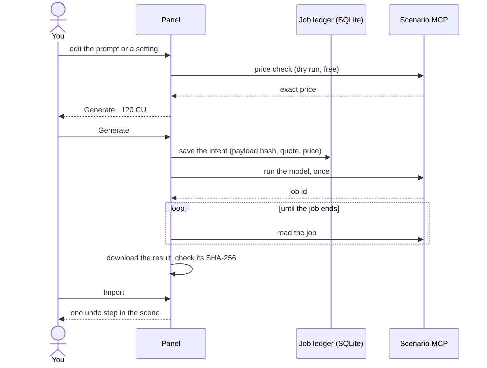
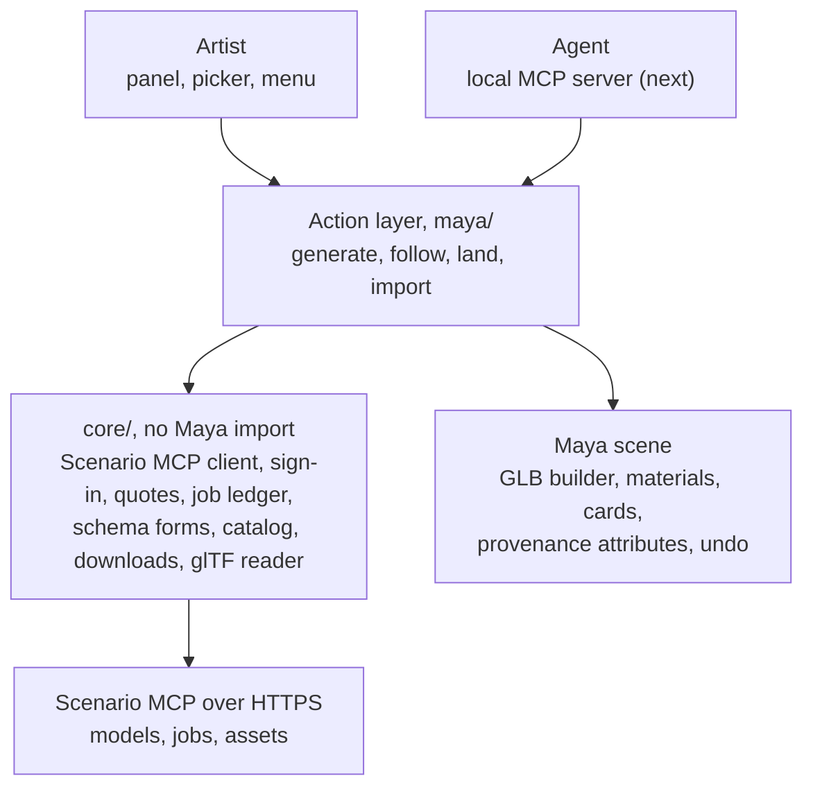

# Scenario for Maya

Every Scenario model inside Autodesk Maya, for artists and for agents.


Scenario for Maya is a plug-in for Maya 2025, 2026 and 2027. Write a prompt
in a docked panel, see the exact price on the Generate button, and the result
lands in the open scene: a 3D model on the ground in front of the camera, or
an image as a card, a material or an image plane. Each landing is one Ctrl+Z.
Every request is priced before it is sent, sent once, and recorded on disk, so
a crash or a dropped connection never charges twice.

**Status:** in development, not released. Tested on Maya 2027.2 on macOS, in
the real Maya window and headless with `mayapy`. Two tabs work today, Image
and 3D; the table lists what comes next.

| Area | Today | Next |
| --- | --- | --- |
| Sign-in | Browser (OAuth), a code on another device, or an API key; secrets in the system keychain | |
| Panel | Docked beside the Channel Box and restored with the workspace; team and project picker; model picker; job list | Studio window, quick composer over the viewport |
| 3D | Text to 3D with Meshy 7.1, Meshy T2.5, Tripo P2 and Rodin Gen-2.5; GLB import with PBR materials, skins, blend shapes and animation; import checks | Image to 3D and multi-view, then edits on your own meshes: retexture, remesh, UV unwrap, rig, animate, split into parts |
| Image | Text to image with Scenario's image models; lands as a card, a material or an image plane | Image editing, upscale, LoRAs |
| Jobs | One job list for every Maya session; downloads resume; results that finish while Maya is closed are offered on the next start | Results history, an "In this scene" view |
| Agents | | A local Scenario MCP server inside Maya, so Claude Code, Codex or Cursor drive the same actions |
| Other lanes | | Materials, environment (sky domes), render a view, video, audio, motion |

## Generate a 3D model


*Recorded in Maya 2027.2 with a live Scenario model. The wait for Scenario
is sped up; everything else plays in real time. Videos:
[this flow](docs/media/flow-3d.mp4), [the whole session](docs/media/session.mp4).*

| 1. Priced before sending | 2. Followed on Scenario | 3. Imported and checked |
| --- | --- | --- |
|  |  |  |

1. Open the **3D** tab. The default model is Meshy 7.1 Text-to-3D, preset to
   a 30,000-face game mesh (the raw mesh is close to a million triangles for
   the same price). **Change** lists the other text-to-3D models, with Meshy
   T2.5 Smart Topology as the low-cost choice.
2. Write a prompt. The button shows the exact price as soon as Scenario has
   checked it; the check is free.
3. **Generate** sends the request once. The card follows the job, downloads
   the GLB when it is ready and shows what came back: format, faces and size
   in metres, with Scenario's preview picture.
4. **Import** adds the model as a new group at the size Scenario returns, its
   bottom centre on the ground below the camera's centre of interest.
   Materials are openPBR, with their textures written to
   `sourceimages/scenario/`. The panel reports the import checks: size,
   materials and textures, non-manifold edges, missing textures. One Ctrl+Z
   removes the whole import; redo brings it back.

<p align="center"></p>
<p align="center"><sub>Viewport 2.0 with one key light. <a href="docs/media/turntable.mp4">MP4</a></sub></p>

Any local GLB can be imported the same way with **Scenario > Import GLB...**,
without signing in. Maya has no glTF importer for scripts, so the plug-in
builds the scene itself: meshes with UVs and normals, PBR materials, joints,
skins, blend shapes and the first animation clip.

## Generate an image

| Ready | As a card facing the camera | As a material on a selected mesh |
| --- | --- | --- |
|  |  |  |

The **Image** tab works the same way. A result lands as a **Card** (a
textured plane facing the camera, at its centre of interest), a **Material**
(base colour of a new material on the selected meshes or faces) or an
**Image plane** on the current camera. Files go to `sourceimages/scenario/`.

## Choose a model


**Change** opens the picker for the current tab: the tab's quick picks
first, then the other models of that kind in Scenario's catalog, with search,
a **Team models** filter for your team's own models, and legacy models on
request.

## How a request is paid

The plug-in follows the same money rules as Scenario's other plug-ins. They
sit in `core/`, below every button and every agent tool, so no caller can
skip them.



- A quote is used once and is bound to the exact model, settings, workspace
  and scene. Any edit asks for a new price. Quotes expire after 120 seconds.
- The intent is written to disk before the paid request. If Maya crashes or
  the connection drops while it is being sent, the job shows as **Not
  confirmed** and blocks an identical request until you link it to a Scenario
  job or mark it checked.
- The plug-in sets no spending cap of its own. Team limits set on Scenario
  apply, and `SCENARIO_NO_SPEND=1` refuses every paid call.

## How it is built

Pure Python on `maya.cmds`, OpenMaya and PySide6: one code base for every
supported Maya and platform, nothing to compile.



- Network and file work runs on worker threads; scene changes run on Maya's
  main thread through one dispatcher, so the interface stays responsive
  during a download.
- Each landing runs inside a recording command, so a whole import (meshes,
  materials, textures, placement) is one undo step and redo restores the same
  nodes.
- Every landed node carries its provenance (asset, job, model, prompt, price)
  as plain string attributes, so scenes open on machines without the plug-in.
- Files on disk:

```
<Maya project>/
  scenario/<date>/<name>/          the GLB and its scenario.json record
  sourceimages/scenario/<name>/    images, and the textures written from a GLB
```

## Install from a checkout

1. Clone this repository.
2. Drag `ScenarioForMaya/scripts/install_scenario.py` onto a Maya viewport. It
   copies the module into your Maya modules folder, loads the plug-in, turns
   on autoload and opens the Scenario panel. No restart and no `userSetup.py`
   edit.
3. Maya 2027 asks whether to load a plug-in from a location it does not trust
   yet. Choose **Allow**; tick "Apply to all plugins in this location" to stop
   it asking again.

For development, point Maya at the checkout instead of copying it. Run this
once in the Script Editor (Python); run it again to reload after a change:

```python
import sys

sys.path.insert(0, "/path/to/maya-plugin/ScenarioForMaya/scripts")
import install_scenario

install_scenario.install(link=True)
```

or set `MAYA_MODULE_PATH=/path/to/maya-plugin` (the repository's
`ScenarioForMaya.mod` uses a relative path) and load `scenario_for_maya` in
Windows > Settings/Preferences > Plug-in Manager.

## Sign in


Open the Scenario panel (Scenario > Scenario Panel) and choose **Sign in with
Scenario**: your browser opens, you approve, and Maya picks up the session.
"Sign in on another device" shows a code to enter on any device; "Use an API
key" takes a key and secret from Scenario's web app.

Secrets go to the system keychain (macOS Keychain, Windows Credential Manager
or Secret Service), never to the scene or Maya's preferences. For scripts and
CI, `SCENARIO_API_KEY` and `SCENARIO_API_SECRET` are read from the
environment.

Nothing is sent to Scenario until you press Generate or allow an agent to.
What the plug-in sends and stores is in [docs/PRIVACY.md](docs/PRIVACY.md).

<br clear="right">

## Tests

| Layer | What it covers | Where it runs |
| --- | --- | --- |
| Unit | `core/` against a fake Scenario MCP and OAuth server: money rules, quotes, ledger recovery, downloads, the glTF reader | Python 3.11 and 3.13 on Linux, macOS and Windows (CI) |
| `mayapy` | Plug-in load and unload, GLB import with undo and redo, the Image and 3D tabs end to end against the fake server, the panel | A Mac with Maya: `tools/test_maya.sh` |
| GUI | Scripted sessions in the real Maya window: install, sign-in, restart recovery, live generation, undo after a click | A Mac with Maya: `tools/test_maya_gui.sh`, `tools/readme_media.sh` |
| Contract | Reads and dry runs against the live Scenario MCP, nothing spent | Weekly in CI with a test key |

The pictures and recordings on this page come from `tools/readme_media.sh`,
which drives the panel in a real Maya 2027.2 session with live Scenario
models and checks undo and redo on the way.

## More

- Design and decisions: [docs/spec/SPEC.md](docs/spec/SPEC.md)
- Changes: [CHANGELOG.md](CHANGELOG.md)
- Contributing and the repository rules: [CONTRIBUTING.md](CONTRIBUTING.md), [AGENTS.md](AGENTS.md)
- Help: [SUPPORT.md](SUPPORT.md); security reports: [SECURITY.md](SECURITY.md)
- License: [MIT](LICENSE)
