# Scenario for Maya

Every Scenario model inside Autodesk Maya, for artists and for agents.

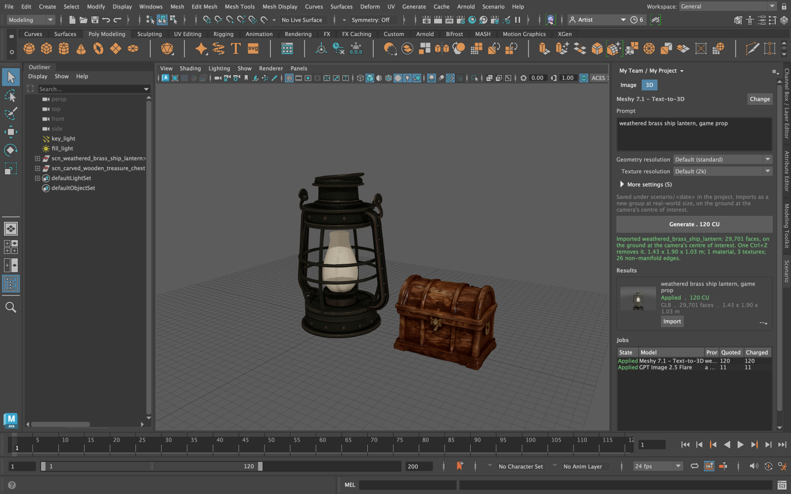

Scenario for Maya is a plug-in for Maya 2025, 2026 and 2027. Write a prompt
in a docked panel, see the exact price on the Generate button, and the result
lands in the open scene: a 3D model on the ground in front of the camera, or
an image as a card, a material or an image plane. A 3D model can start from a
prompt, an image, or views of an object captured in the scene, and a mesh of
the scene can be remeshed, UV unwrapped or retextured. Each landing is one
Ctrl+Z.
Every request is priced before it is sent, sent once, and recorded on disk, so
a crash or a dropped connection never charges twice.

**Status:** in development, not released. Tested on Maya 2027.2 on macOS, in
the real Maya window and headless with `mayapy` (the Multi-view and Edit
selection modes headless only so far). Two tabs work today, Image and 3D; the table lists
what comes next.

| Area | Today | Next |
| --- | --- | --- |
| Sign-in | Browser (OAuth), a code on another device, or an API key; secrets in the system keychain | |
| Panel | Docked beside the Channel Box and restored with the workspace; team and project picker; model picker; job list | Studio window, quick composer over the viewport |
| 3D | Text to 3D (Meshy 7.1, Meshy T2.5, Tripo P2, Rodin Gen-2.5) and image to 3D (Meshy 7.1, Tripo P2, Rodin Gen-2.5, Tripo 3.1, Hunyuan 3D Pro 3.1) from a file, a viewport capture or an Image result; multi-view to 3D from views captured around a selected object (Tripo P2, Tripo 3.1, Hunyuan 3D Pro 3.1), landed over it; edits of a selected mesh (remesh, UV unwrap, retexture), imported fitted over it or applied onto it (new UVs, a new material or new geometry, reviewed first, one Ctrl+Z); GLB import with PBR materials, skins, blend shapes and animation; import checks | Rig, animate, split into parts; motion; FBX results |
| Image | Text to image with Scenario's image models; lands as a card, a material or an image plane | Image editing, upscale, LoRAs |
| Jobs | One job list for every Maya session; downloads resume; results that finish while Maya is closed are offered on the next start | Results history, an "In this scene" view |
| Agents | | A local Scenario MCP server inside Maya, so Claude Code, Codex or Cursor drive the same actions |
| Other lanes | | Materials, environment (sky domes), render a view, video, audio, motion |

## Generate a 3D model

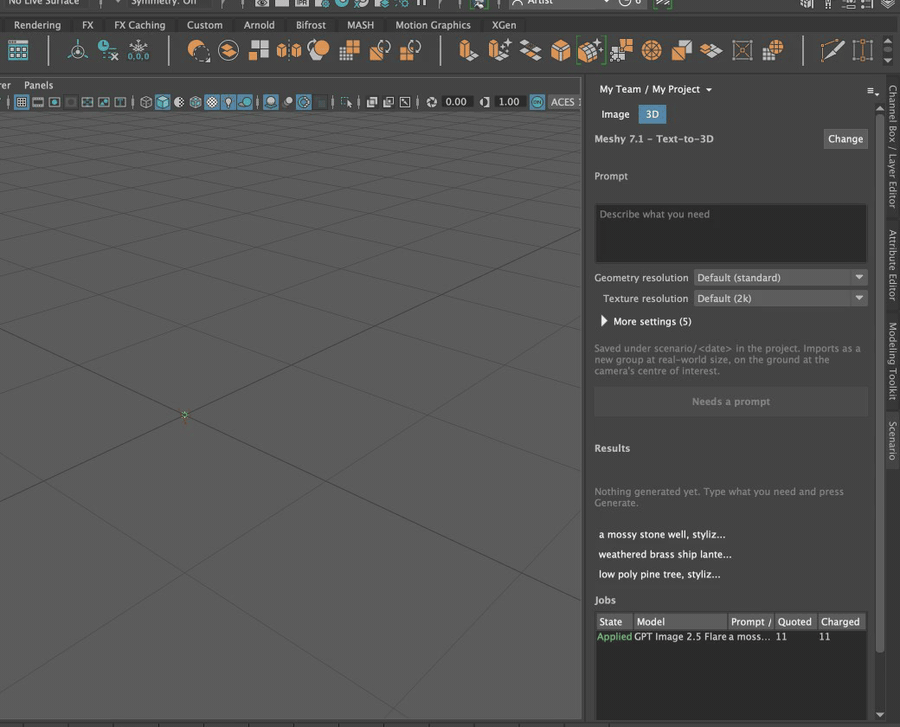

*Recorded in Maya 2027.2 with a live Scenario model. The wait for Scenario
is sped up; everything else plays in real time. Videos:
[this flow](docs/media/flow-3d.mp4), [the whole session](docs/media/session.mp4).*

| 1. Priced before sending | 2. Followed on Scenario | 3. Imported and checked |
| --- | --- | --- |
| 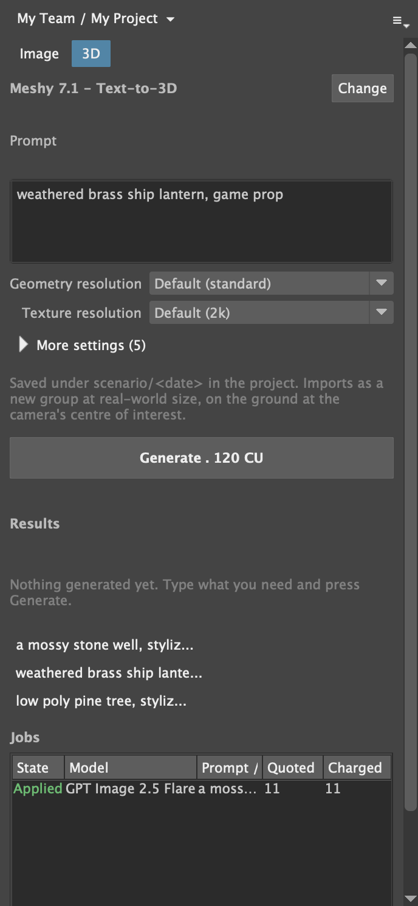 | 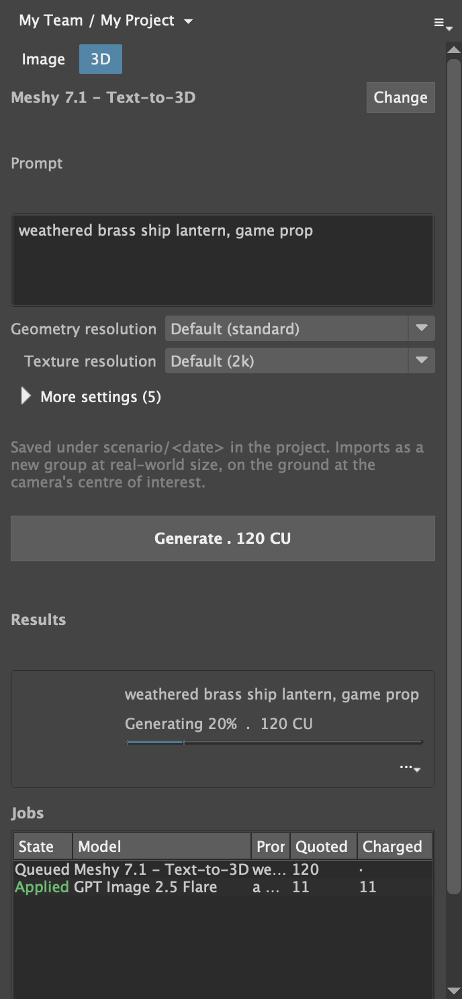 | 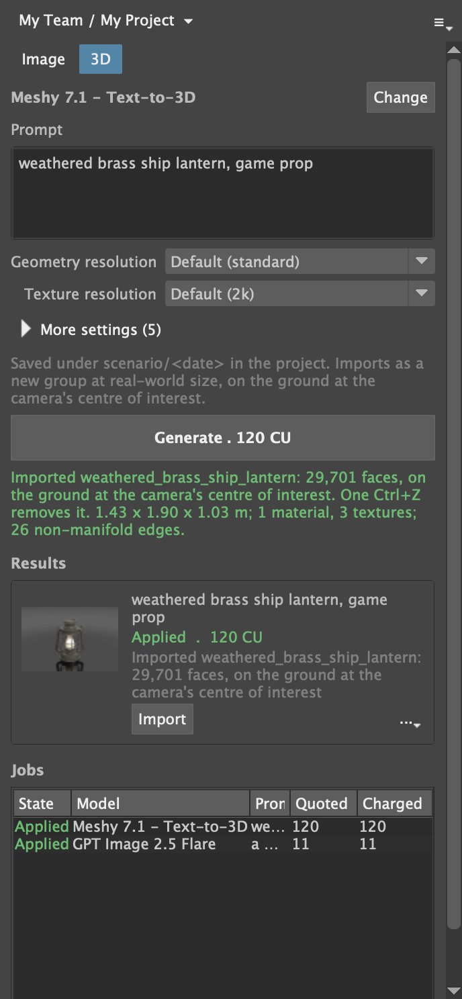 |

1. Open the **3D** tab. The default model is Meshy 7.1 Text-to-3D, preset to
   a 30,000-face game mesh (the raw mesh is close to a million triangles for
   the same price). **Change** lists the other text-to-3D models, with Meshy
   T2.5 Smart Topology as the low-cost choice.
2. Write a prompt. The button shows the exact price as soon as Scenario has
   checked it; the check is free.
3. **Generate** sends the request once. The card follows the job, downloads
   the GLB when it is ready and shows what came back: format, faces and size
   in metres, with Scenario's preview picture.
4. **Import** adds the model as a new group at the size Scenario returns, its
   bottom centre on the ground below the camera's centre of interest.
   Materials are openPBR, with their textures written to
   `sourceimages/scenario/`. The panel reports the import checks: size,
   materials and textures, non-manifold edges, missing textures. One Ctrl+Z
   removes the whole import; redo brings it back.

<p align="center">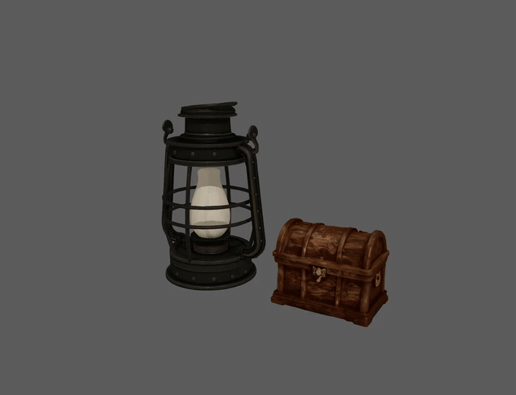</p>
<p align="center"><sub>Viewport 2.0 with one key light. <a href="docs/media/turntable.mp4">MP4</a></sub></p>

Any local GLB can be imported the same way with **Scenario > Import GLB...**,
without signing in. Maya has no glTF importer for scripts, so the plug-in
builds the scene itself: meshes with UVs and normals, PBR materials, joints,
skins, blend shapes and the first animation clip.

## Turn an image into a 3D model

| The image | The model, imported in Maya |
| --- | --- |
| 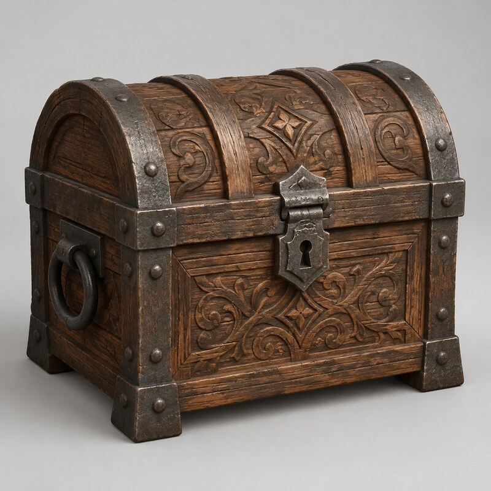 |  |

<p align="center">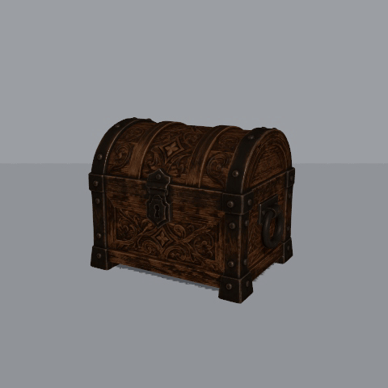</p>

*The image was generated in the Image tab with GPT Image 2.5 Flare. The
model is Meshy 7.1 Image to 3D at the 30,000-face preset (28,984 faces),
imported by the plug-in and rendered in Maya's Viewport 2.0 with
`tools/render_glb.py`.*

1. Open the **3D** tab and choose **Image** (beside **Text**).
2. Add the image: **File...** for a PNG, JPEG or WebP; **Viewport** for a
   capture of the view you look through, with the grid and the selection
   highlight hidden; **Image results** for anything made in the Image tab.
   An Image result also has **Make a 3D model from this image** in its menu,
   which opens this mode with the image in place.
3. A file or a capture is sent to your Scenario project when you add it
   (once per session: the same file added again is not sent twice). An
   Image result is already on Scenario and is used as it is.
4. The price shows on **Generate**, then the result card follows the job,
   downloads the GLB and offers **Import**, as for text to 3D. A job
   without a prompt is named after its image.

One clear image of one object works best. Meshy 7.1 also takes up to four
views of the same object; models that take one image use the first.

**Which model.** Both quick picks below started from the image above, one
run each:

| Meshy 7.1 Image to 3D, the default | Tripo P2 |
| --- | --- |
| 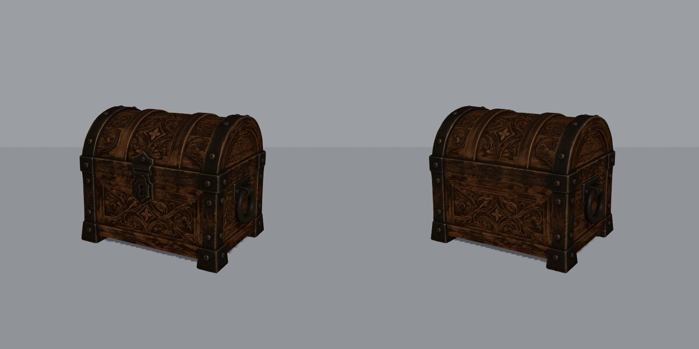 | 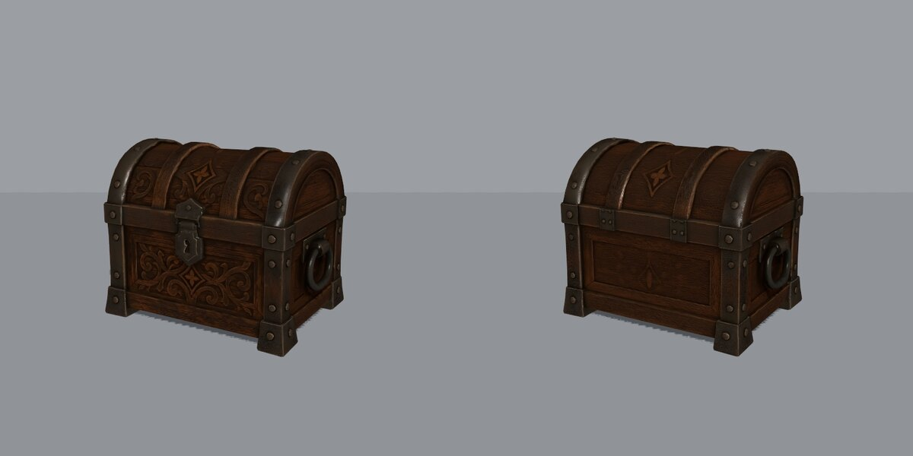 |
| 28,984 faces (30,000 preset), carving kept on every side, about 140 s, 120 CU, up to four views | 4,222 faces, clean mesh with flatter carving and a plain back, about 85 s, 220 CU, one image |

## Turn views of an object into a 3D model

The **Multi-view** mode builds a model from pictures of one object taken from
named sides. Start from a blockout, a kitbash or an old asset in your scene:
the plug-in photographs it from the front, left, back and right, and the
model returns a textured mesh of the same object, facing the same way.

| | Front, left, back, right |
| --- | --- |
| Captured around a blockout |  |
| Tripo P2 Multi View, the default | 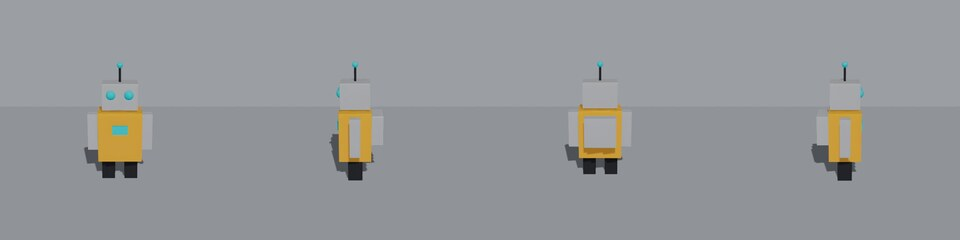 |
| Tripo 3.1 Multi View | 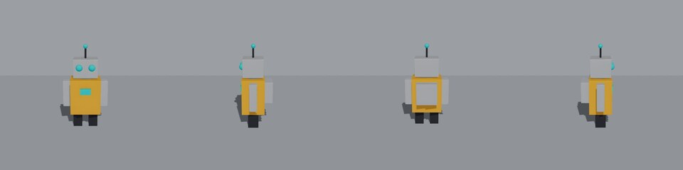 |

<p align="center">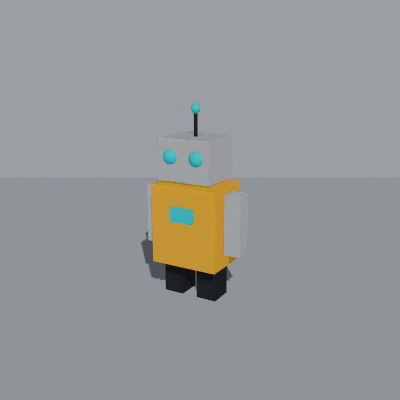 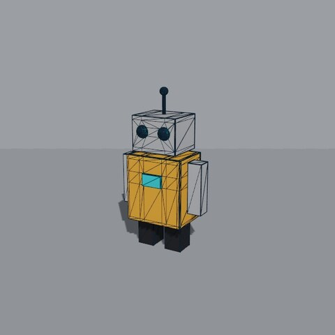</p>

*A robot blocked out from cubes in Maya, its four views captured by the
plug-in, and one run of each Tripo model on those views. Results rendered in
Viewport 2.0 with `tools/render_glb.py`; right, Tripo P2's mesh with every
edge drawn.*

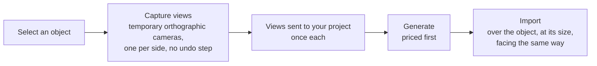

1. Open the **3D** tab and choose **Multi-view**. Each view the model takes
   has a slot: Front, Left, Back and Right for the Tripo models; Hunyuan 3D
   Pro 3.1 adds Top, Bottom and the two front three-quarter views.
2. Select one object and press **Capture views**. The plug-in renders it from
   each side with temporary orthographic cameras, all at one scale, clipped
   close around the object so the floor and its neighbours stay out of the
   pictures. Nothing is added to the scene or to the undo queue, and the
   render settings it touches are put back. Left is the object's own left:
   with the object facing front (+Z), the side Maya's Right view shows.
3. A slot also takes a file or an Image result, from its menu. Each view is
   sent to your Scenario project once. The Tripo models need the front and
   at least one more view; the Generate button says what is missing, then
   shows the price.
4. **Import** places the result over the object its views came from, at the
   object's size and facing the same way, as a new group (the object itself
   is not changed). Views added as files land like any 3D result, on the
   ground in front of the camera.

**Which model.** Same four views, one run each:

| Model | Faces | GLB | Price |
| --- | --- | --- | --- |
| Tripo P2 Multi View, the default | 4,987, a clean low-poly mesh | 1.4 MB | 220 CU |
| Tripo 3.1 Multi View, the low-cost choice | 1,425,173, dense | 42 MB | 45 CU |
| Hunyuan 3D Pro 3.1 Multiview | starts at 40,000, its lightest setting | not run yet | 120 CU |

Both Tripo results kept the shape and colours on every side, took under four
minutes and landed on the blockout within half a centimetre of its 82 cm
height.

## Edit a mesh of the scene

The **Edit selection** mode of the 3D tab sends one of your meshes to an
edit model and brings the result back: over the mesh as a new object, or
onto the mesh itself.

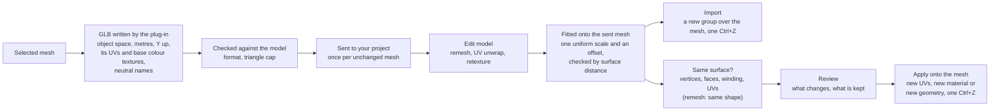

1. Select one mesh (the object, or some of its faces) and open **3D**,
   **Edit selection**.
2. Choose the task: **Remesh**, **UV unwrap** or **Retexture**. Each task
   keeps its own model; the defaults are Tripo Retopology v3, Tripo Smart UV
   and Meshy 7 Retexture.
3. **Use selection** writes the mesh as a GLB in the project's
   `images/scenario/captures` folder. Object, scene and path names stay on
   your machine: the file says `scn_input_0`. The mesh is checked against
   the model before anything is sent (Tripo Smart UV takes up to 80,000
   triangles, Meshy UV Unwrap 44,000, Hunyuan UV Unwrapping 30,000); a mesh
   it cannot take shows why and is not sent.
4. Retexture needs a prompt. The price shows on **Generate**.
5. **Import** places the result over the mesh it came from, as a new group,
   even if you moved the mesh after sending it. Your mesh is not changed.
6. **Apply...** writes the result onto the mesh itself, after a review of
   what changes, what is kept and what needs your confirmation. One Ctrl+Z
   undoes it.

Most edit models return the mesh resized and centred: on 2026-10-19, Tripo
models returned it 1 m long (also when it was sent 1.5 m off the origin),
Meshy Remesh and Meshy 7 Retexture 2 m long, while Meshy UV Unwrap returned
it in place; none rotated it. The plug-in keeps the file it sent and fits the
result back onto it with one uniform scale and an offset from the bounding
boxes, then applies the mesh's current transform. It then checks that the two
surfaces meet: 1,500 points spread over each must lie within 2% of the mesh's
size from the other (at most 5% farther, none beyond 10%). A result that fails
still lands over the mesh, and the import message says it is not the same shape.

**What came back.** A bevelled crate of 1,052 triangles with the cube's
default UVs, sent by the plug-in, one run per model:

| Your mesh | Meshy 7 Retexture | Tripo 3.0 Texturing |
| --- | --- | --- |
| 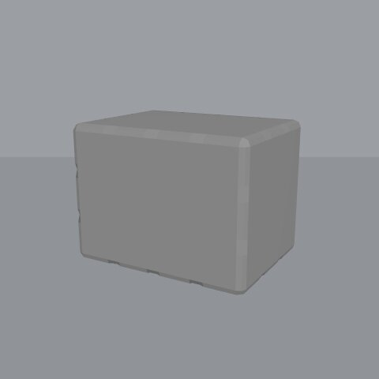 | 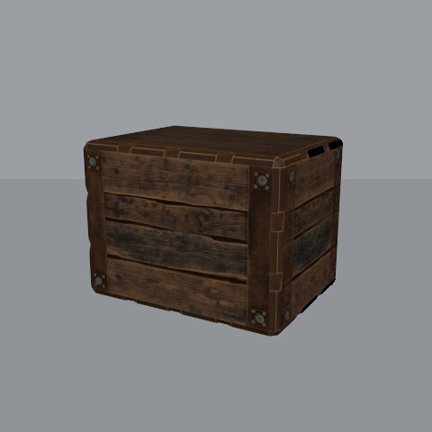 | 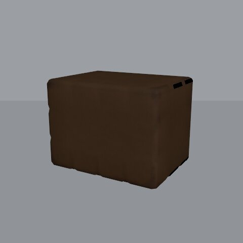 |
| 1,052 triangles | Same triangles and the same UVs; base colour, normal, metallic and roughness maps; 40 CU | Same triangles and the same UVs; PBR textures; 15 CU |

| Your UVs, on a checker | Tripo Smart UV |
| --- | --- |
| 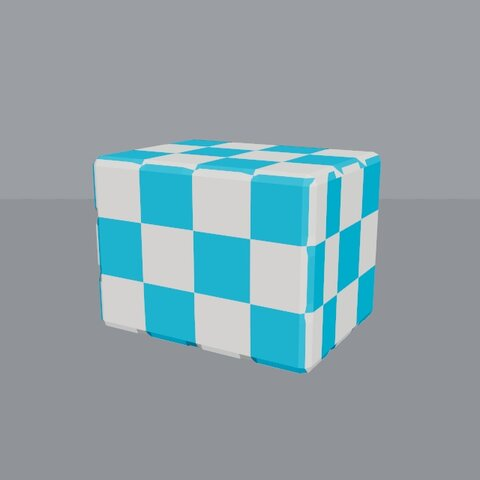 | 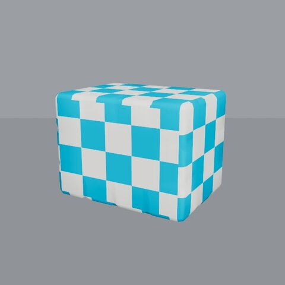 |
| The cube's default layout | A new layout on the same triangles; 40 CU |

| What was sent | Meshy Remesh | Tripo Retopology v3 |
| --- | --- | --- |
| 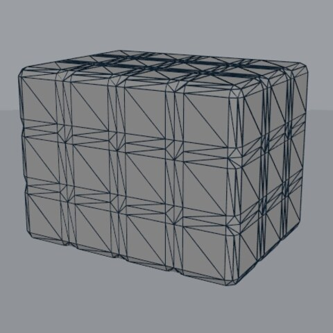 | 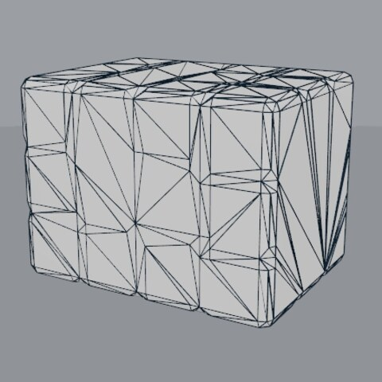 | 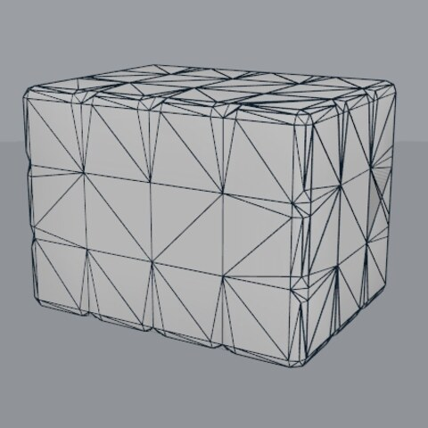 |
| 1,052 triangles (398 faces in Maya) | 522 triangles, new UVs, base colour and metal-roughness maps baked; 20 CU | 560 triangles, a baked normal map; 70 CU |

*Stills rendered headless in Maya's Viewport 2.0 with `tools/render_glb.py`
(`--checker 6` for the UV pair, `--wire` for the remeshes).*

**Apply.** Before anything changes, the plug-in proves the result is the
same surface as your mesh (`core/topology.py`): every result vertex sits on
a vertex of the mesh after the fit, every triangle lies inside one face with
the same winding, every face is covered exactly, and each face corner gets
one UV. A remesh has new triangles by design, so Replace geometry asks for
the same shape instead, by the surface-distance check above. Then:

| Task | What Apply changes | What it keeps |
| --- | --- | --- |
| UV unwrap | The current UV set gets the result's UVs | The old layout as `<set>_scnPrev`, geometry, other UV sets, materials |
| Retexture | A new material from the result's maps (base colour, metal and roughness, normal) is assigned to the mesh; UVs too if the model changed them | The old material, unassigned; Maya's default material is never edited |
| Remesh | The mesh's shape is replaced by the result's mesh, under your transform and with your shape's name; it gets the result's material when the result has textures, otherwise keeps yours | The transform (name, place, attributes, parent, sets, connections); the old shape, hidden, as `<shape>_scnPrev` with its history; connections from the old shape move to the new one |

All five results above apply onto the crate: the texture and UV results
exactly, the two remeshes as Replace geometry (farthest point 0.4% and 0.5%
of the crate's size from the original surface). Apply asks before deleting
the mesh's construction history (history would overwrite new UVs) and when
a mesh with several materials would get one; it refuses deformed (skinned),
referenced and locked meshes, and Replace geometry refuses instanced ones,
in this version.

## Generate an image

| Ready | As a card facing the camera | As a material on a selected mesh |
| --- | --- | --- |
| 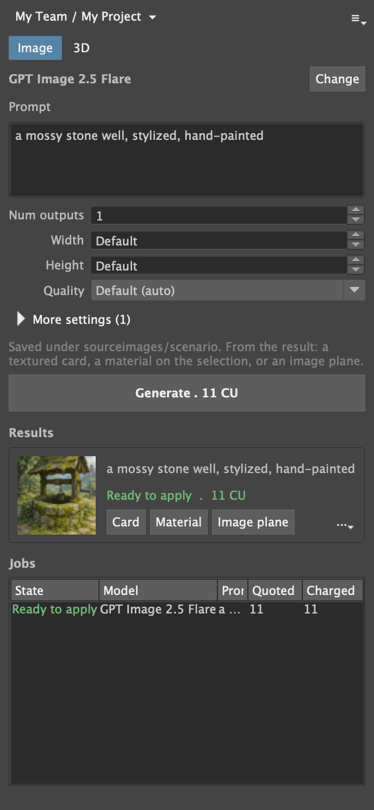 | 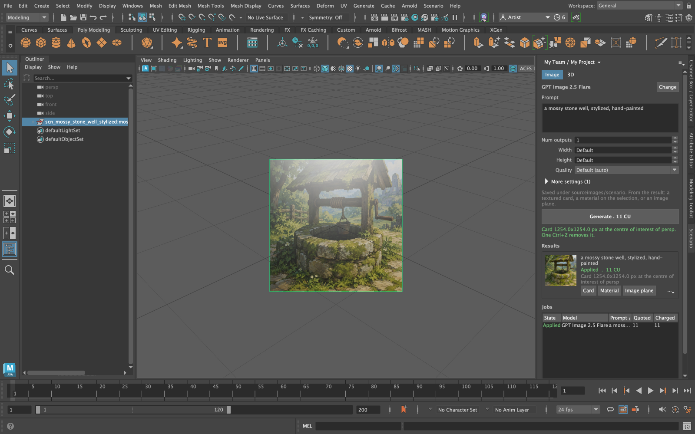 | 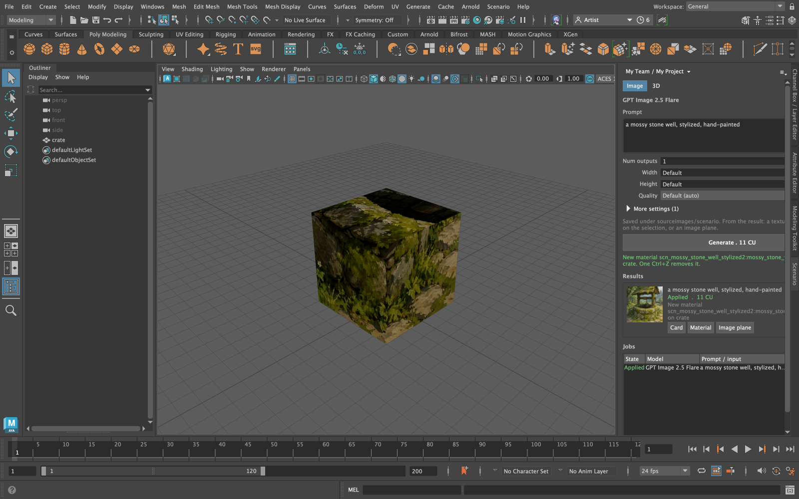 |

The **Image** tab works the same way. A result lands as a **Card** (a
textured plane facing the camera, at its centre of interest), a **Material**
(base colour of a new material on the selected meshes or faces) or an
**Image plane** on the current camera. Files go to `sourceimages/scenario/`.

## Choose a model

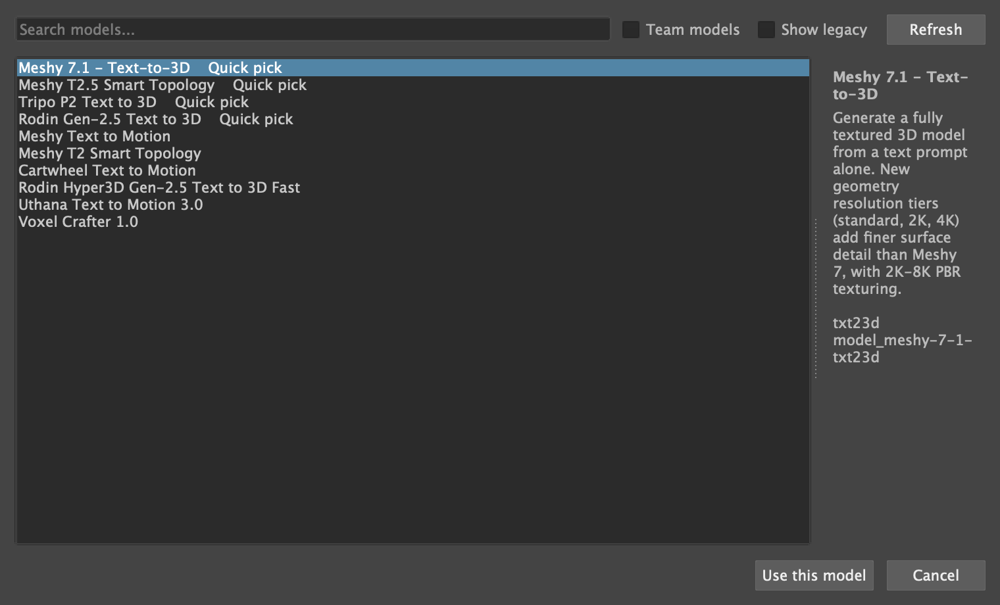

**Change** opens the picker for the current tab: the tab's quick picks
first, then the other models of that kind in Scenario's catalog, with search,
a **Team models** filter for your team's own models, and legacy models on
request.

## How a request is paid

The plug-in follows the same money rules as Scenario's other plug-ins. They
sit in `core/`, below every button and every agent tool, so no caller can
skip them.

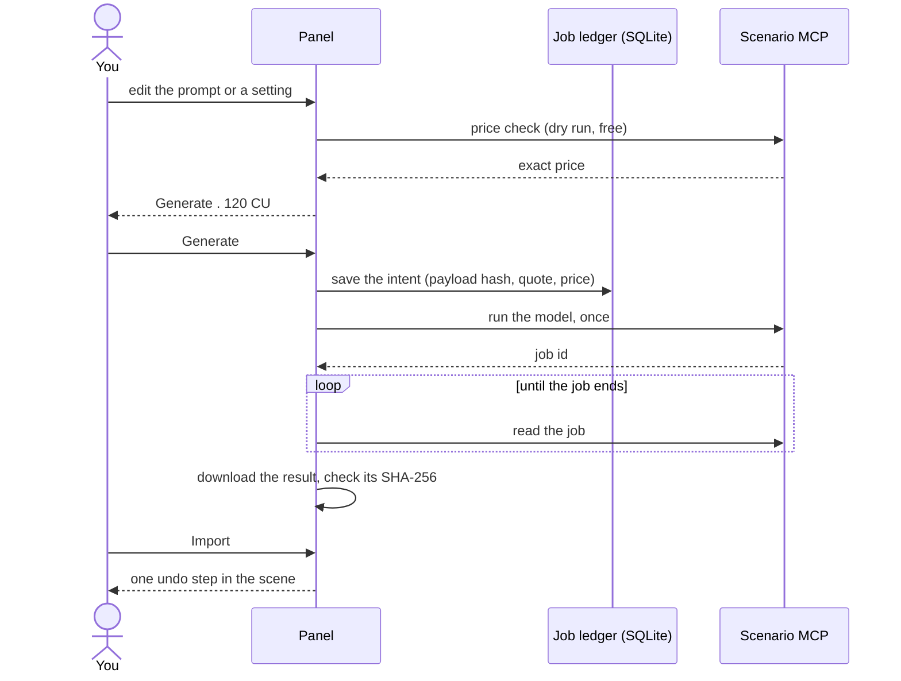

- A quote is used once and is bound to the exact model, settings, workspace
  and scene. Any edit asks for a new price. Quotes expire after 120 seconds.
- The intent is written to disk before the paid request. If Maya crashes or
  the connection drops while it is being sent, the job shows as **Not
  confirmed** and blocks an identical request until you link it to a Scenario
  job or mark it checked.
- The plug-in sets no spending cap of its own. Team limits set on Scenario
  apply, and `SCENARIO_NO_SPEND=1` refuses every paid call.

## How it is built

Pure Python on `maya.cmds`, OpenMaya and PySide6: one code base for every
supported Maya and platform, nothing to compile.

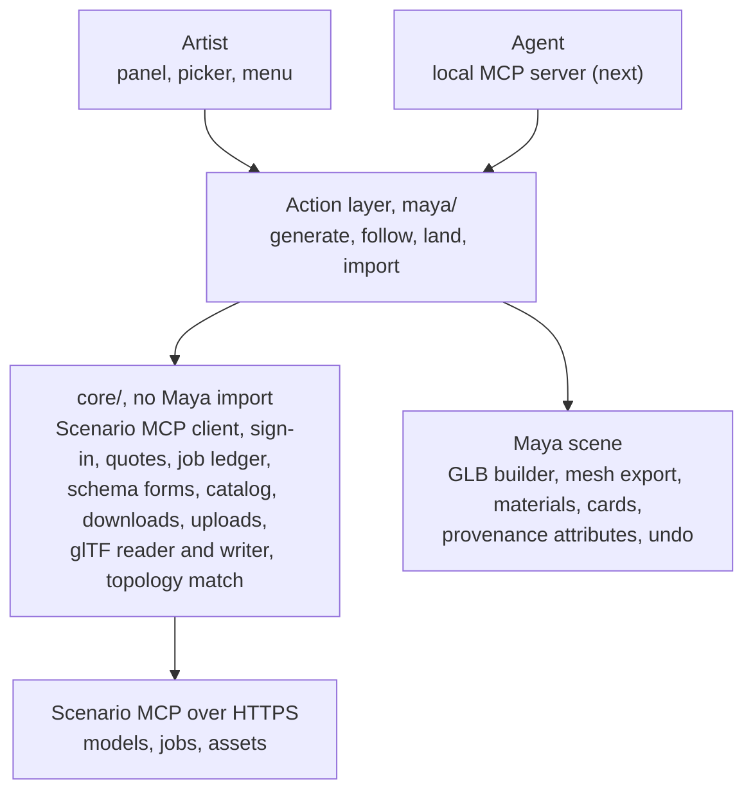

- Network and file work runs on worker threads; scene changes run on Maya's
  main thread through one dispatcher, so the interface stays responsive
  during a download.
- Each landing runs inside a recording command, so a whole import (meshes,
  materials, textures, placement) is one undo step and redo restores the same
  nodes.
- Every landed node carries its provenance (asset, job, model, prompt, price)
  as plain string attributes, so scenes open on machines without the plug-in.
- Files on disk:

```
<Maya project>/
  scenario/<date>/<name>/          the GLB and its scenario.json record
  sourceimages/scenario/<name>/    images, and the textures written from a GLB
```

## Install from a checkout

1. Clone this repository.
2. Drag `ScenarioForMaya/scripts/install_scenario.py` onto a Maya viewport. It
   copies the module into your Maya modules folder, loads the plug-in, turns
   on autoload and opens the Scenario panel. No restart and no `userSetup.py`
   edit.
3. Maya 2027 asks whether to load a plug-in from a location it does not trust
   yet. Choose **Allow**; tick "Apply to all plugins in this location" to stop
   it asking again.

For development, point Maya at the checkout instead of copying it. Run this
once in the Script Editor (Python); run it again to reload after a change:

```python
import sys

sys.path.insert(0, "/path/to/maya-plugin/ScenarioForMaya/scripts")
import install_scenario

install_scenario.install(link=True)
```

or set `MAYA_MODULE_PATH=/path/to/maya-plugin` (the repository's
`ScenarioForMaya.mod` uses a relative path) and load `scenario_for_maya` in
Windows > Settings/Preferences > Plug-in Manager.

## Sign in

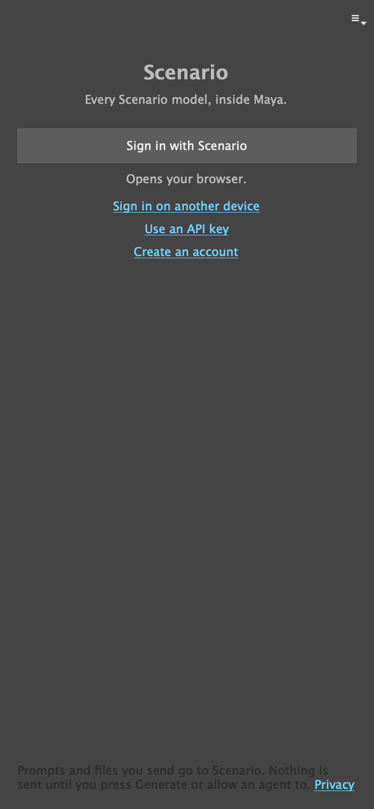

Open the Scenario panel (Scenario > Scenario Panel) and choose **Sign in with
Scenario**: your browser opens, you approve, and Maya picks up the session.
"Sign in on another device" shows a code to enter on any device; "Use an API
key" takes a key and secret from Scenario's web app.

Secrets go to the system keychain (macOS Keychain, Windows Credential Manager
or Secret Service), never to the scene or Maya's preferences. For scripts and
CI, `SCENARIO_API_KEY` and `SCENARIO_API_SECRET` are read from the
environment.

Nothing is sent to Scenario until you press Generate or allow an agent to.
What the plug-in sends and stores is in [docs/PRIVACY.md](docs/PRIVACY.md).

<br clear="right">

## Tests

| Layer | What it covers | Where it runs |
| --- | --- | --- |
| Unit | `core/` against a fake Scenario MCP and OAuth server: money rules, quotes, ledger recovery, downloads, the glTF reader | Python 3.11 and 3.13 on Linux, macOS and Windows (CI) |
| `mayapy` | Plug-in load and unload, GLB import with undo and redo, the Image and 3D tabs end to end against the fake server (image upload, viewport capture without an undo step, an Image result sent to 3D), the panel | A Mac with Maya: `tools/test_maya.sh` |
| GUI | Scripted sessions in the real Maya window: install, sign-in, restart recovery, live generation, undo after a click | A Mac with Maya: `tools/test_maya_gui.sh`, `tools/readme_media.sh` |
| Contract | Reads and dry runs against the live Scenario MCP, nothing spent | Weekly in CI with a test key |

The pictures and recordings on this page come from `tools/readme_media.sh`,
which drives the panel in a real Maya 2027.2 session with live Scenario
models and checks undo and redo on the way.

## More

- Design and decisions: [docs/spec/SPEC.md](docs/spec/SPEC.md)
- Changes: [CHANGELOG.md](CHANGELOG.md)
- Contributing and the repository rules: [CONTRIBUTING.md](CONTRIBUTING.md), [AGENTS.md](AGENTS.md)
- Help: [SUPPORT.md](SUPPORT.md); security reports: [SECURITY.md](SECURITY.md)
- License: [MIT](LICENSE)
