# User Guide

Scenario for Maya puts Scenario's models in a panel docked beside the Channel
Box. You describe what you need, or hand it something from your scene (an
image, views of an object, a mesh, a character), see the exact price on the
Generate button, and the result comes back into the open scene as one undo
step. This guide covers every mode with real results; the pictures come from
Maya 2027.2 with live Scenario models.

## Quick start

1. Install the plug-in: download `scenario-maya-<version>.zip` from
   [maya.scenario.com/download/latest](https://maya.scenario.com/download/latest),
   unzip it and drag `install_scenario.py` onto a Maya viewport
   ([Install](../README.md#install)).
2. In the Scenario panel, choose **Sign in with Scenario** and approve in your
   browser. If your account has several teams or projects, pick one.
3. Open the **3D** tab, keep the **Text** mode and its default model, Meshy
   7.1, and write a prompt: `weathered brass ship lantern, game prop`.
4. The button shows the price once Scenario has checked it, for example
   `Generate . 120 CU`; the check is free. Press it.
5. When the card says Ready to apply, press **Import**. The lantern lands on
   the ground in front of the camera at its real size. Ctrl+Z removes it in
   one step.

## Find your way around

<p align="center">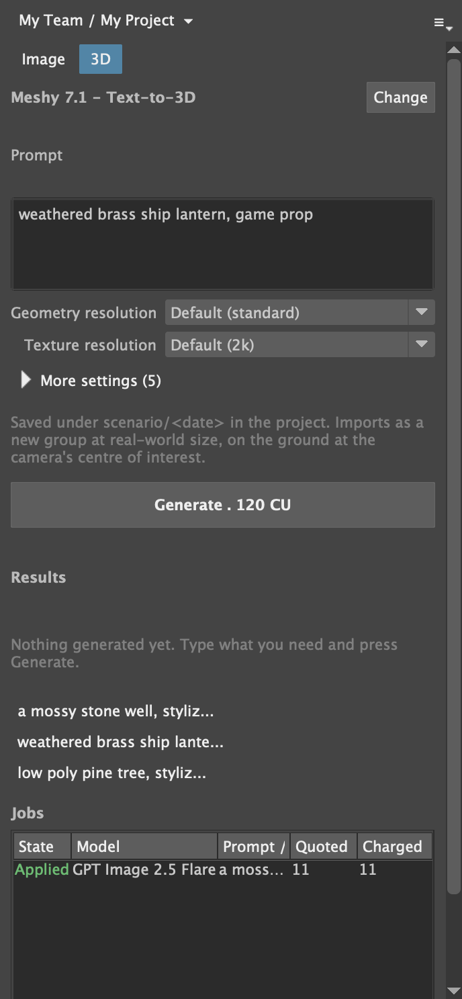</p>

### The panel

Open it with **Scenario > Scenario Panel**. It docks beside the Channel Box
and comes back with your workspace layout. From top to bottom:

- **Workspace**: the team and project the panel works in (`My Team / My
  Project`). Click it to switch. Prices, uploads, results and the job list
  belong to that project.
- **Tabs**: **Image** and **3D**. The 3D tab has five modes: **Text**,
  **Image**, **Multi-view**, **Edit selection** and **Motion**. A tab opens on
  the mode you used last in it.
- **The mode**: its model, with **Change** to pick another; the inputs the
  mode needs (an image, views, a mesh, a character); the prompt, which hides
  when the model takes none; the model's settings, read from Scenario; and the
  **Generate** button with its price. Ctrl+Enter presses it.
- **Results**: one card per job of this mode, with its status, its price and
  the actions valid now (Import or Apply... for 3D; Card, Material or Image
  plane for an image; Retry download). Before the first result, example
  prompts to start from. The **...** menu of a card has Show file, Open on
  Scenario, Re-run settings (fills the form with that job's settings, sends
  nothing) and Copy details.
- **Jobs**: every job of the project, from every Maya session (see
  [Jobs and recovery](#jobs-and-recovery)).

The **☰** button at the top right has Workspace..., Refresh jobs, Copy
diagnostics, the handbook, Privacy, Report a problem and Sign out.

### The Scenario menu

Maya's main menu bar gets a **Scenario** menu: Scenario Panel, Jobs, Import
GLB... (any GLB, no sign-in needed), Workspace..., Sign In... or Sign Out, and
Help (Handbook, Privacy, Report a Problem, Copy Diagnostics, About).

### Sign in

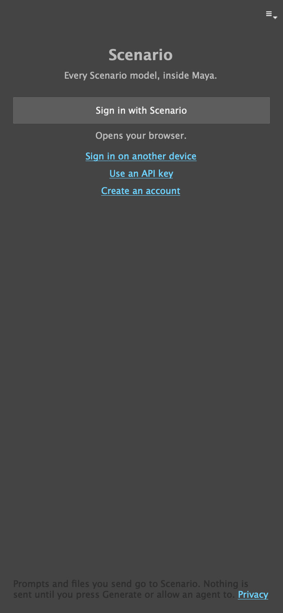

- **Sign in with Scenario**: your browser opens on Scenario's sign-in page,
  you approve, and Maya picks up the session.
- **Sign in on another device**: the panel shows a code to enter on any
  device, for a machine without a browser.
- **Use an API key**: a key and its secret from your project's API keys on
  [app.scenario.com](https://app.scenario.com).

Secrets go to the system's credential store (macOS Keychain, Windows
Credential Manager or Secret Service), never to the scene or Maya's
preferences. Scripts and render farms can set `SCENARIO_API_KEY` and
`SCENARIO_API_SECRET` in the environment instead. Nothing is sent to
Scenario until you sign in.

<br clear="right">

## 3D from a prompt

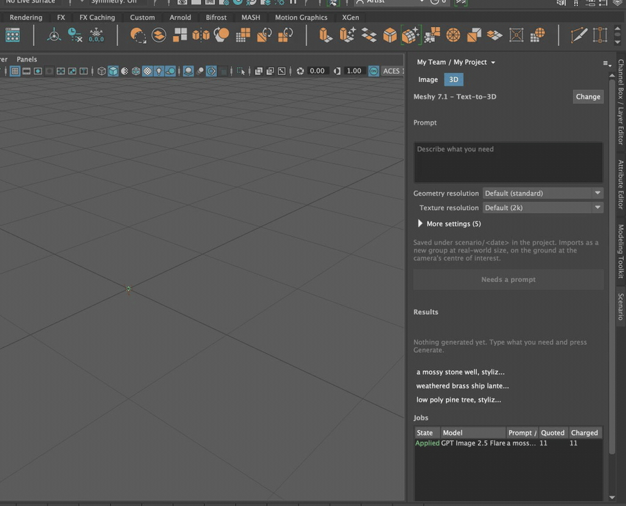

*Recorded in Maya 2027.2 with a live Scenario model. The wait for Scenario
is sped up; everything else plays in real time. Videos:
[this flow](media/flow-3d.mp4), [the whole session](media/session.mp4).*

### Generate

| 1. Priced before sending | 2. Followed on Scenario | 3. Imported and checked |
| --- | --- | --- |
|  | 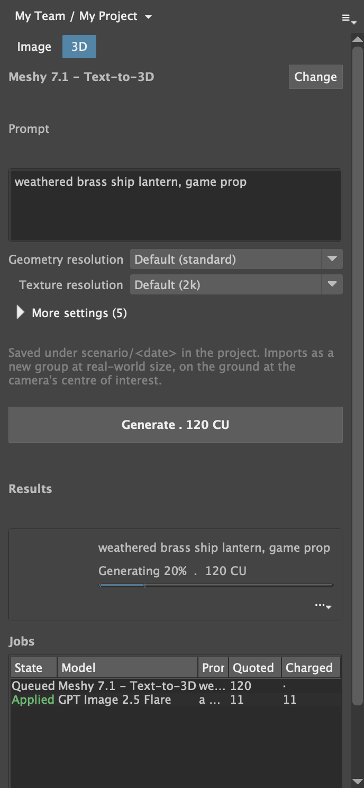 | 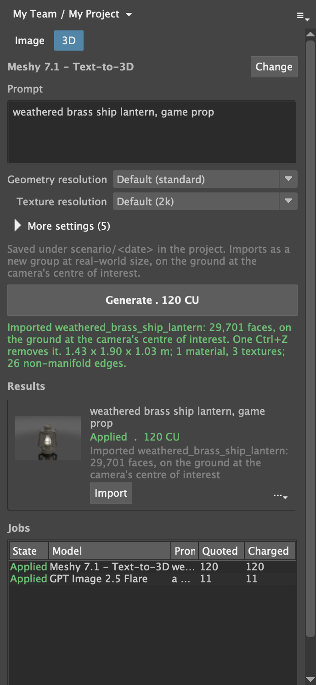 |

1. Open the **3D** tab, **Text** mode. The default model is Meshy 7.1
   Text-to-3D, preset to a 30,000-face game mesh (the raw mesh is close to a
   million triangles for the same price). **Change** lists the other
   text-to-3D models: Meshy T2.5 Smart Topology, the low-cost choice, Tripo P2
   and Rodin Gen-2.5.
2. Describe one object. The button shows the exact price as soon as Scenario
   has checked it.
3. **Generate** sends the request once. The card follows the job, downloads
   the GLB when it is ready and shows what came back: format, faces and size
   in metres, with Scenario's preview picture.

### Import

**Import** adds the model as a new group at the size Scenario returns, its
bottom centre on the ground below the camera's centre of interest. Materials
are OpenPBR, with their textures written to `sourceimages/scenario/`. The
card reports the import checks: size, materials and textures, non-manifold
edges, missing textures. One Ctrl+Z removes the whole import; redo brings it
back.

<p align="center">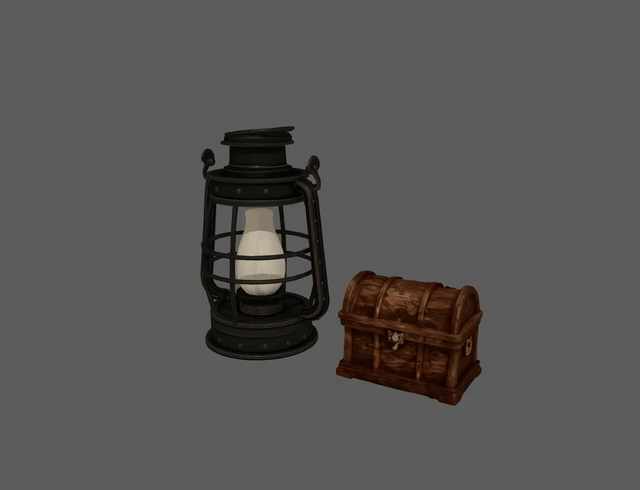</p>
<p align="center"><sub>Viewport 2.0 with one key light. <a href="media/turntable.mp4">MP4</a></sub></p>

### Import any GLB

**Scenario > Import GLB...** imports any local GLB the same way, without
signing in: meshes with UVs and normals, PBR materials, joints, skins, blend
shapes and the first animation clip.

## 3D from an image

| The image | The model, imported in Maya |
| --- | --- |
| 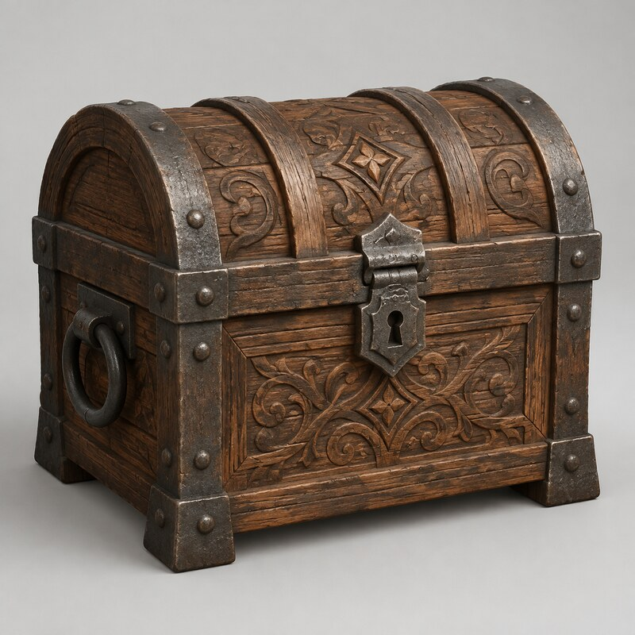 | 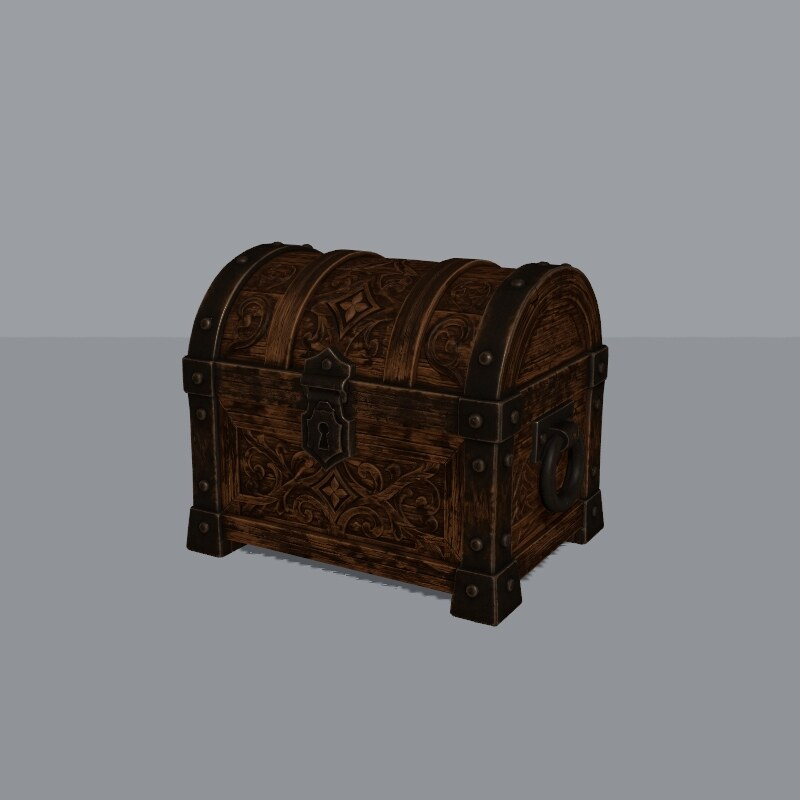 |

*The image was generated in the Image tab with GPT Image 2.5 Flare. The
model is Meshy 7.1 Image to 3D at the 30,000-face preset (28,984 faces),
imported by the plug-in and rendered in Maya's Viewport 2.0.*

### Add the image

1. Open the **3D** tab and choose the **Image** mode.
2. Add the image:
   - **File...**: a PNG, JPEG or WebP;
   - **Viewport**: a capture of the view you look through, with the grid and
     the selection highlight hidden, so a blockout or a quick paint-over can
     be the start;
   - **Image results**: anything made in the Image tab. An Image result also
     has **Make a 3D model from this image** in its **...** menu, which opens
     this mode with the image in place.
3. A file or a capture is sent to your Scenario project when you add it, once
   per session. An Image result is already on Scenario and is used as it is.
4. The price shows on **Generate**; the card then follows the job and offers
   **Import**, as for a prompt. A job without a prompt is named after its
   image.

One clear image of one object, on a plain background, works best. Meshy 7.1
also takes up to four views of the same object; models that take one image
use the first.

### Which model

Both quick picks, from the image above, one run each:

| Meshy 7.1 Image to 3D, the default | Tripo P2 |
| --- | --- |
| 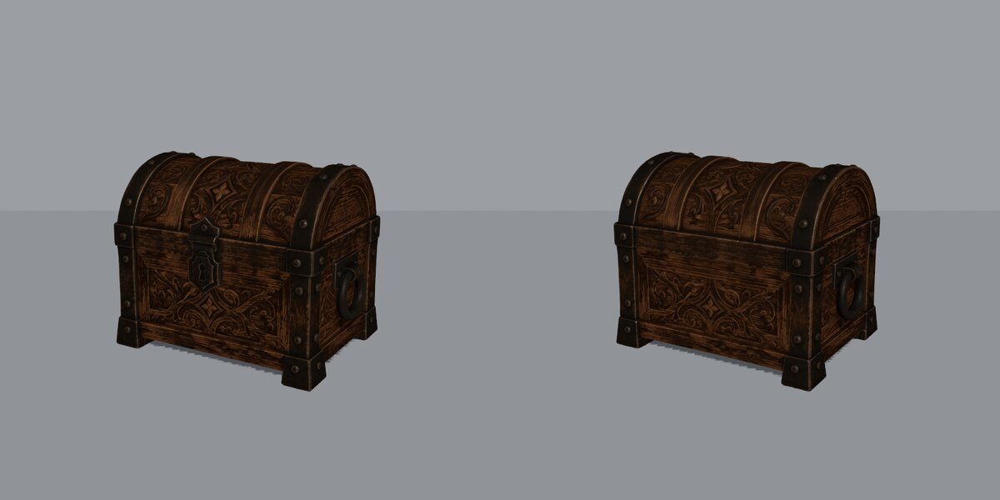 | 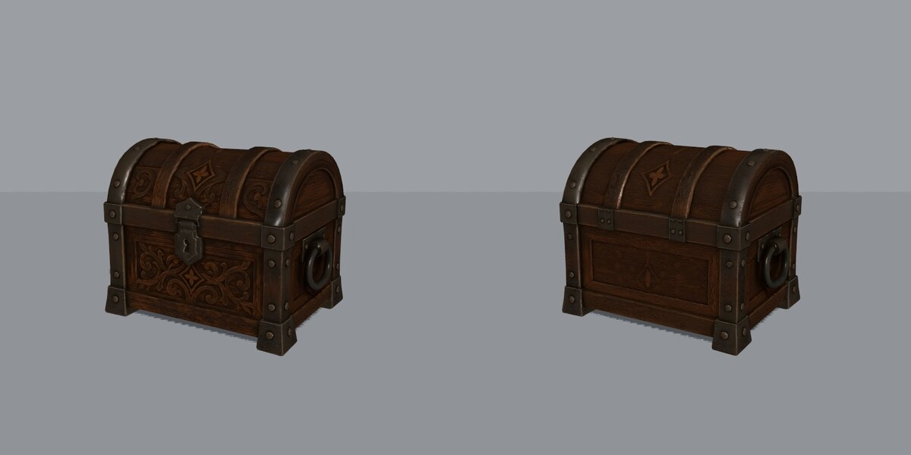 |
| 28,984 faces (30,000 preset), carving kept on every side, about 140 s, 120 CU, up to four views | 4,222 faces, clean mesh with flatter carving and a plain back, about 85 s, 220 CU, one image |

**Change** also lists Rodin Gen-2.5, Tripo 3.1 and Hunyuan 3D Pro 3.1.

## 3D from views of an object

The **Multi-view** mode builds a model from pictures of one object taken from
named sides. Start from a blockout, a kitbash or an old asset in your scene:
the plug-in photographs it from the front, left, back and right, and the
model returns a textured mesh of the same object, facing the same way, landed
over it.

| | Front, left, back, right |
| --- | --- |
| Captured around a blockout |  |
| Tripo P2 Multi View, the default | 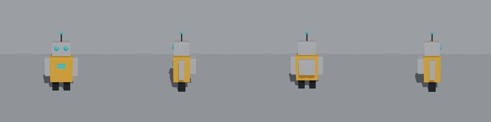 |
| Tripo 3.1 Multi View | 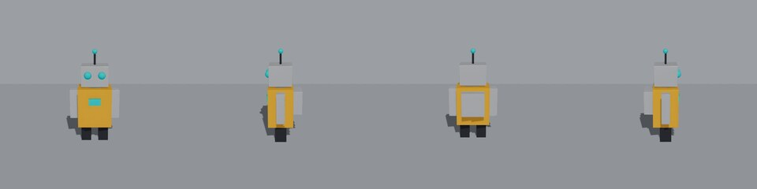 |

### Capture the views

1. Open the **3D** tab and choose **Multi-view**. Each view the model takes
   has a slot: Front, Left, Back and Right for the Tripo models; Hunyuan 3D
   Pro 3.1 adds Top, Bottom and the two front three-quarter views.
2. Select one object and press **Capture views**. The plug-in renders it from
   each side with temporary orthographic cameras, all at one scale, clipped
   close around the object so the floor and its neighbours stay out of the
   pictures. Nothing is added to the scene or to the undo queue, and the
   render settings it touches are put back.
3. Left is the object's own left: with the object facing front (+Z), the side
   Maya's Right view shows. Model your blockout facing +Z.
4. A slot also takes a file or an Image result, from its menu. Each view is
   sent to your project once. The Tripo models need the front and at least
   one more view; the Generate button says what is missing, then shows the
   price.

### Where the result lands

**Import** places the result over the object its views came from, at the
object's size and facing the same way, as a new group. Your object is not
changed: hide it, or keep it to compare. Views added as files land like any
3D result, on the ground in front of the camera.

<p align="center">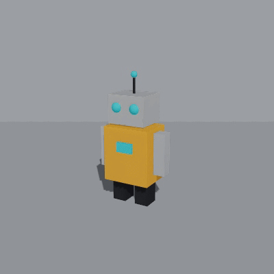 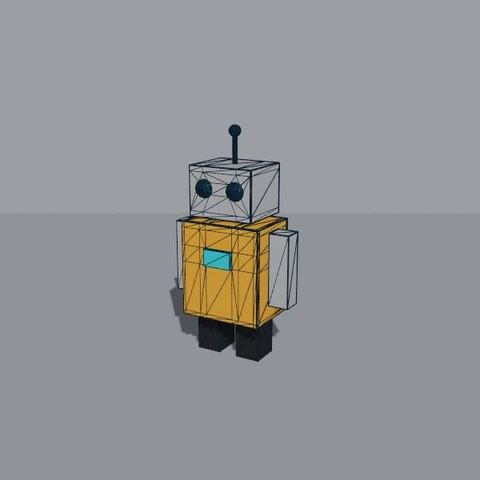</p>

*A robot blocked out from cubes in Maya and one Tripo P2 run on its four
views. Right, the same mesh with every edge drawn.*

### Which model

Same four views, one run each:

| Model | Faces | GLB | Price |
| --- | --- | --- | --- |
| Tripo P2 Multi View, the default | 4,987, a clean low-poly mesh | 1.4 MB | 220 CU |
| Tripo 3.1 Multi View, the low-cost choice | 1,425,173, dense | 42 MB | 45 CU |
| Hunyuan 3D Pro 3.1 Multiview | starts at 40,000, its lightest setting | not run yet | 120 CU |

Both Tripo results kept the shape and colours on every side, took under four
minutes and landed on the blockout within half a centimetre of its 82 cm
height.

## Quad meshes and FBX results

The Tripo models have a **quad** setting: the mesh comes back in quads,
delivered as an FBX file (Scenario sends no GLB then). The plug-in imports it
through Maya's own FBX importer, as one Ctrl+Z, and lands it like a GLB: on
the ground in front of the camera, or over the captured object in the
Multi-view mode.

<p align="center">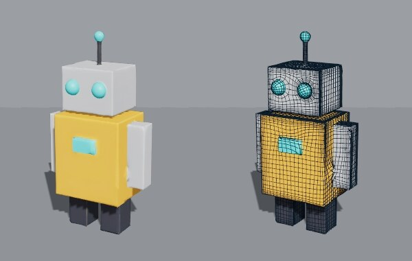</p>

*Tripo 3.1 Multi View with quad on and a face limit of 8,000, from the four
robot views: 8,153 faces, 8,132 of them quads. 53 CU.*

### What the plug-in does around the FBX importer

- Keeps the scene's unit, up axis, playback range, current frame and frame
  rate, which the importer would change.
- Imports even when the scene already has nodes of the same names.
- Writes the file's textures under `sourceimages/scenario/`.
- Cleans up the names the FBX format mangles.
- Keeps the importer's materials, with colour textures in sRGB and the other
  maps Raw.
- Lets skinned meshes follow their joints only, so a rig lands upright in a
  Z-up scene and in one piece wherever it is placed.
- Starts a clip on the scene's start frame, as for a GLB, and reports the same
  import checks.

## Edit a mesh of the scene

The **Edit selection** mode sends one of your meshes to an edit model and
brings the result back: over the mesh as a new object, or onto the mesh
itself.

### Send a mesh

1. Select one mesh (the object, or some of its faces) and open **3D**,
   **Edit selection**.
2. Choose the task: **Remesh**, **UV unwrap** or **Retexture**. Each task
   keeps its own model; the defaults are Tripo Retopology v3, Tripo Smart UV
   and Meshy 7 Retexture.
3. **Use selection** writes the mesh, with its UVs and base colour textures,
   to a file in the project's `images/scenario/captures` folder. Object,
   scene and path names stay on your machine.
4. The mesh is checked against the model before anything is sent (Tripo Smart
   UV takes up to 80,000 triangles, Meshy UV Unwrap 44,000, Hunyuan UV
   Unwrapping 30,000); a mesh it cannot take shows why and is not sent. An
   unchanged mesh is sent once.
5. Retexture needs a prompt. The price shows on **Generate**.

### Import over the mesh

**Import** places the result over the mesh it came from, as a new group, even
if you moved the mesh after sending it. Your mesh is not changed.

Most edit models return the mesh resized and centred. The plug-in keeps the
file it sent, fits the result back onto it and onto the mesh's current place,
then checks that both are the same shape. A result that is not still lands,
and the import message says so.

### What came back

A bevelled crate of 1,052 triangles with the cube's default UVs, one run per
model:

| Your mesh | Meshy 7 Retexture | Tripo 3.0 Texturing |
| --- | --- | --- |
| 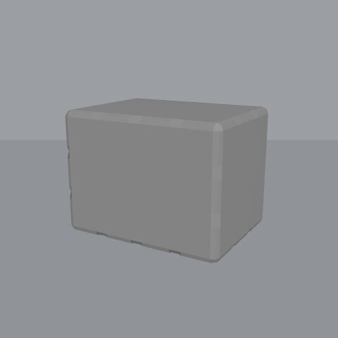 | 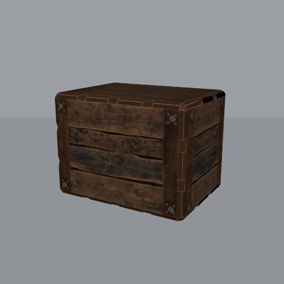 | 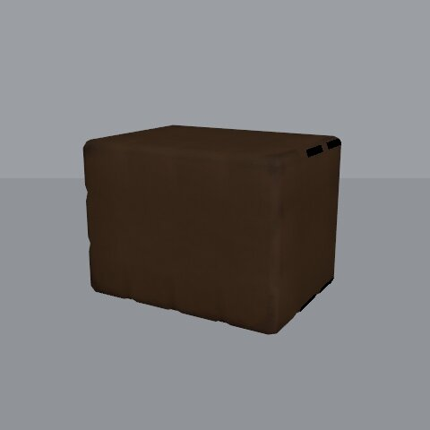 |
| 1,052 triangles | Same triangles and the same UVs; base colour, normal, metallic and roughness maps; 40 CU | Same triangles and the same UVs; PBR textures; 15 CU |

| Your UVs, on a checker | Tripo Smart UV |
| --- | --- |
| 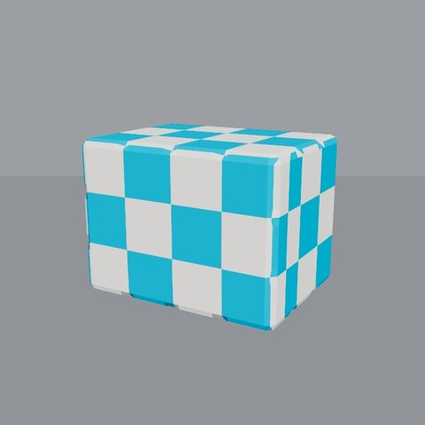 | 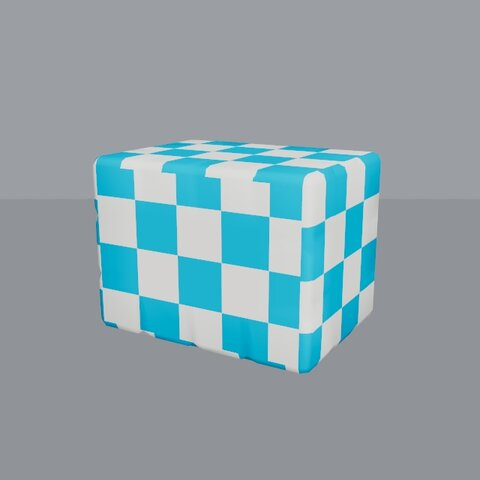 |
| The cube's default layout | A new layout on the same triangles; 40 CU |

| What was sent | Meshy Remesh | Tripo Retopology v3 |
| --- | --- | --- |
| 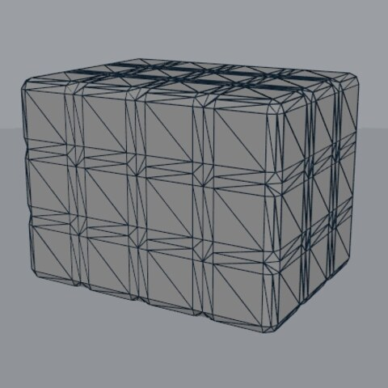 | 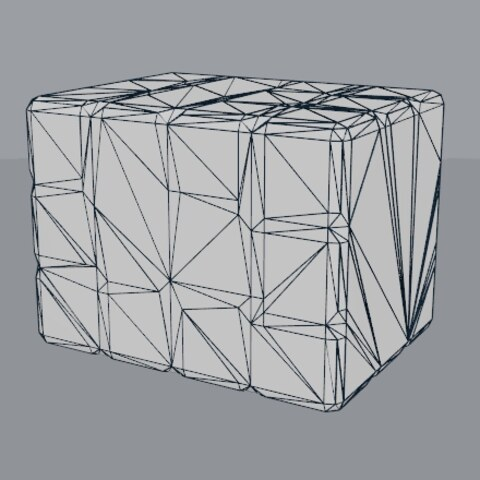 | 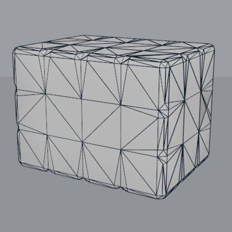 |
| 1,052 triangles (398 faces in Maya) | 522 triangles, new UVs, base colour and metal-roughness maps baked; 20 CU | 560 triangles, a baked normal map; 70 CU |

### Apply onto the mesh

**Apply...** writes the result onto the mesh itself. Before anything changes,
the plug-in checks that the result is the same surface as your mesh (for a
remesh, the same shape), then a review lists what changes, what is kept and
what needs your confirmation. One Ctrl+Z undoes the whole apply.

| Task | What Apply changes | What it keeps |
| --- | --- | --- |
| UV unwrap | The current UV set gets the result's UVs | The old layout as `<set>_scnPrev`, geometry, other UV sets, materials |
| Retexture | A new material from the result's maps (base colour, metal and roughness, normal) is assigned to the mesh; UVs too if the model changed them | The old material, unassigned; Maya's default material is never edited |
| Remesh | The mesh's shape is replaced by the result's mesh, under your transform and with your shape's name; it gets the result's material when the result has textures | The transform (name, place, attributes, parent, sets, connections); the old shape, hidden, as `<shape>_scnPrev` with its history |

All five results above apply onto the crate.

### What Apply asks or refuses

- It asks before deleting the mesh's construction history, which would
  overwrite new UVs, and before giving one material to a mesh that has
  several.
- It refuses deformed (skinned), referenced and locked meshes in this
  version, and a remesh refuses instanced ones. **Import** still works
  on them.

## Animate a character

The **Motion** mode turns a prompt into a character that moves: a skinned
mesh, its joints and a clip, imported as one Ctrl+Z. Some models bring their
own character; others rig and animate yours.

<p align="center">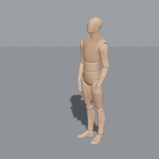 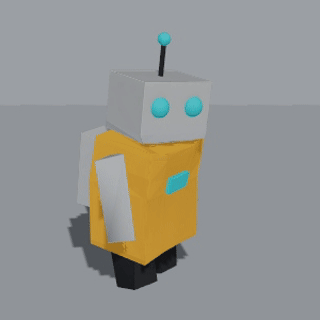</p>

*"waves hello with the right hand". Left, Meshy Text to Motion from the
prompt alone: its own mannequin, 52 joints, 3 seconds. Right, Uthana Text to
Motion 3.0 on the robot from the Multi-view chapter, sent from the scene:
rigged with 52 joints and animated for 4 seconds.*

### From a prompt alone

Open the **3D** tab and choose **Motion**. The default model, Meshy Text to
Motion, needs only the prompt: one simple action works best (a walk, a wave,
a jump), 2 to 10 seconds, 40 CU whatever the length.

### On your own character

1. Press **Change** and pick Uthana Text to Motion 3.0 or Cartwheel Text to
   Motion.
2. Select the character (its group or its meshes) and press **Use
   selection**. The meshes are written as one GLB, with neutral names, and
   sent to your project once. Nothing is added to the scene or to the undo
   queue. Cartwheel needs a character, and the Generate button says so until
   one is sent; Uthana takes one or makes its own.
3. **Import** lands the result over your character, at its size, measured on
   the clip's first frame. Your character is not changed.

Model the character standing, facing front (+Z), arms away from the body.
Check which way a rig faces before animating further: in our test,
Cartwheel's rig faced the robot's back.

### Frame rate and timeline

- A model's frame-rate setting starts at the scene's rate when the model
  offers it (Uthana: 24, 30 or 60 fps). When a clip was made at another rate
  (30 fps in a 24 fps scene), its keys fall between frames and the result
  says so.
- The clip starts on the scene's start frame; the playback range is not
  changed.

### Which model

One prompt, one run each:

| Model | Character | Result | Price |
| --- | --- | --- | --- |
| Meshy Text to Motion, the default | Its own wooden mannequin (52 joints) | FBX, in about 30 seconds | 40 CU, 2 to 10 s |
| Uthana Text to Motion 3.0, first pick for your character | Yours (auto-rigged) or its own (160 joints) | GLB, in about 3 minutes | 104 CU for 4 s; 124 CU with a character |
| Cartwheel Text to Motion | Yours, required | Maya FBX, in 2 to 4 minutes | 72 CU for 3 s |

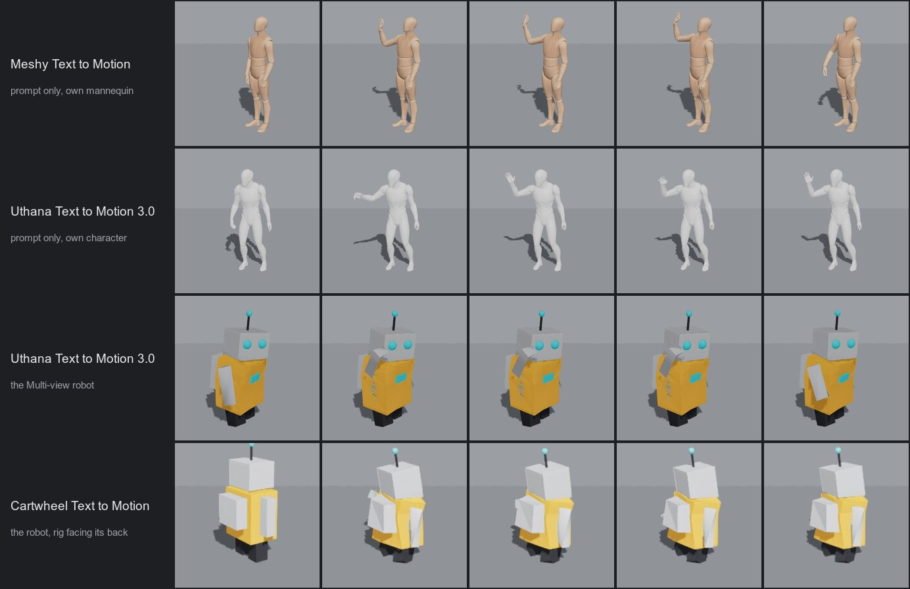

## Generate an image

| Ready | As a card facing the camera | As a material on a selected mesh |
| --- | --- | --- |
| 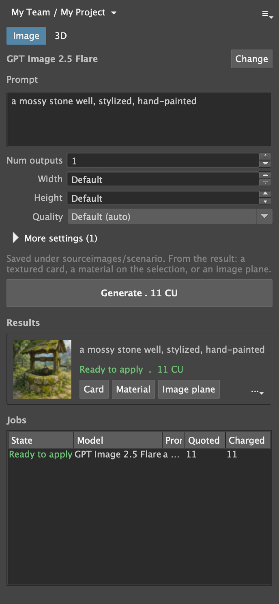 | 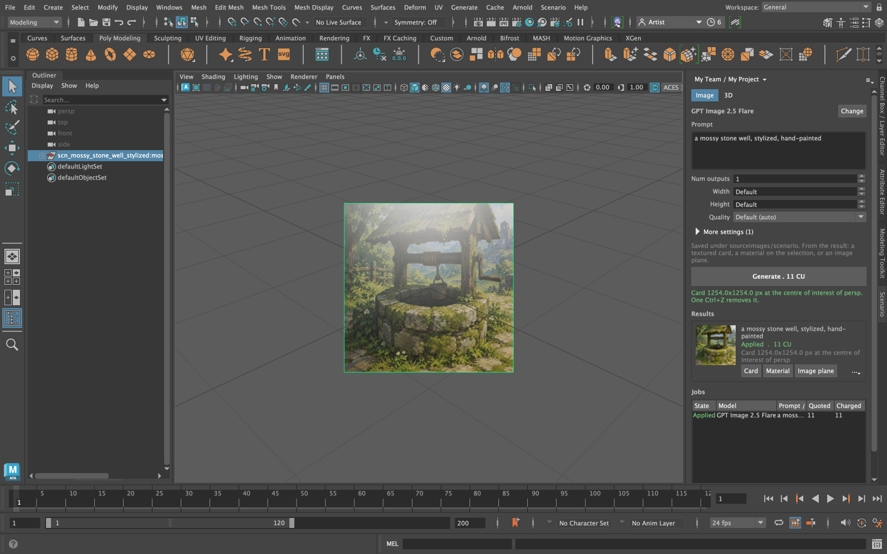 | 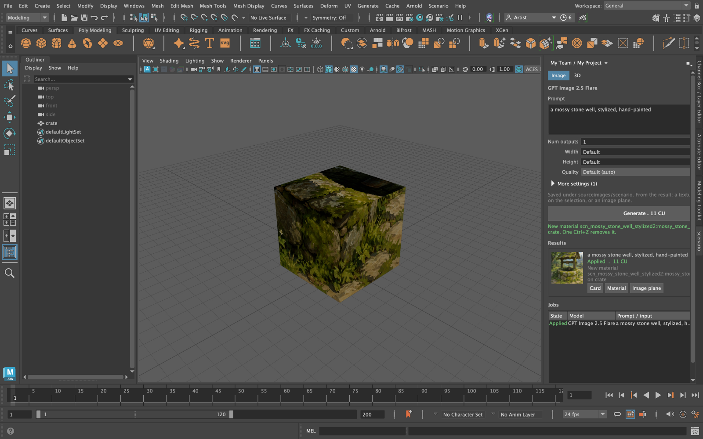 |

### Land it in the scene

The **Image** tab prices and generates like the 3D tab (default model: GPT
Image 2.5 Flare). A ready image lands three ways, each one Ctrl+Z:

- **Card**: a textured plane facing the camera, at its centre of interest. Use
  it as a reference board next to your model.
- **Material**: base colour of a new material on the selected meshes or faces.
- **Image plane**: on the current camera, to model or animate against.

Files go to `sourceimages/scenario/`.

### Turn it into a 3D model

**Make a 3D model from this image**, in a result's **...** menu, opens 3D,
Image with the image in place: concept, then mesh, without leaving Maya.

## Choose a model

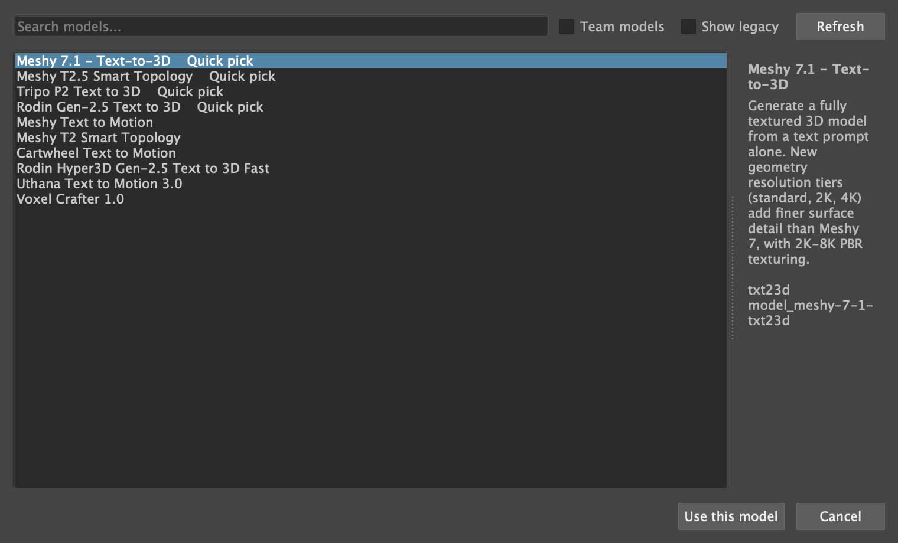

**Change** opens the picker for the current mode: the mode's quick picks
first, the ones this guide compares, then the other models of that kind in
Scenario's catalog, with search, a **Team models** filter for your team's
own models, and **Show legacy** for older models. The settings below the
prompt follow the model you pick, read from Scenario; the catalog is kept
for a day per project.

## Prices and spending

### The price on the button

Every request is priced before it is sent. When you edit the prompt or a
setting, the panel asks Scenario for the price, a free check, and the button
shows it: `Generate . 120 CU`. **Price unavailable (Retry)** means the check
failed; nothing was spent.

### What the plug-in guarantees

- A price is valid for the exact request it was checked for, for two
  minutes. Any edit asks for a new price.
- The job is saved on your computer before the request is sent, and it is
  sent once. If Maya crashes or the connection drops while it is being sent,
  the job shows as **Not confirmed** (see below) rather than being sent again.
- The plug-in sets no spending cap of its own. Your team's limits on Scenario
  apply.

### Ask before spending, or never spend

- `confirm_above_cu` in the [settings file](#settings) makes Generate ask
  before any request priced above that many CU.
- `SCENARIO_NO_SPEND=1` in Maya's environment refuses every paid request; the
  button then reads `Spending off` beside the price.

## Jobs and recovery

### The job list

**Jobs**, at the bottom of the panel or in the Scenario menu, lists every job
of the project from every Maya session, newest first: state, model, prompt or
input, quoted and charged CU. Right-click a job for **Copy details** (local
and Scenario job ids, prices, times, the error and its hint), for a support
request.

A job goes through Preparing, Submitting, Queued, Starting, Generating (with
a percentage when Scenario reports one), Finalizing, Finished and
Downloading to Ready to apply, then Applied once it is in the scene. It can
also end as Failed, Blocked (refused by Scenario's content rules), Download
failed, Canceled or Not confirmed.

### When Maya closes

Jobs live on Scenario, not in Maya. Close Maya during a long generation and,
at the next start, the panel offers the results that finished meanwhile:
press **Download**. A download that stopped resumes from where it was, with a
fresh link; **Retry download** on the card does the same by hand. If Scenario
cannot be read several times in a row, delivery pauses and the card says why.

### Not confirmed

A job is **Not confirmed** when Maya stopped, or the connection dropped,
while its paid request was being sent: Scenario may or may not have received
it, and may have charged it. Maya warns at the next start. To protect you
from paying twice, the plug-in blocks the identical request (same project,
model and settings). Check your project's jobs on
[app.scenario.com](https://app.scenario.com) before generating it again.
Changing anything in the request sends a new one.

## Files and folders

Results go into the current Maya project (**File > Set Project**), so they
travel with your scene:

```
<Maya project>/
  scenario/<date>/<name>/          each result: the GLB or FBX and its scenario.json record
  sourceimages/scenario/<name>/    images, and the textures written from a 3D result
  images/scenario/captures/        viewport captures, views and the meshes sent for an edit
```

Every node the plug-in creates carries its provenance (model, prompt, price,
job and asset ids) as plain string attributes, so the scene opens on machines
without the plug-in and anyone can tell where an asset came from. Anyone you
send the scene to can read those prompts; set `store_prompts_on_nodes` to
`false` in the settings to leave them out.

The plug-in's own files (settings, the job list, the model catalog cache and
logs) are in `scenario/` inside Maya's user folder (`MAYA_APP_DIR`).

## Settings

The panel has no settings page yet. The few settings live in
`<Maya user folder>/scenario/settings.json`, which never holds a secret.
Edit it with Maya closed: Maya writes the file and would overwrite the
change.

| Setting | Default | Effect |
| --- | --- | --- |
| `confirm_above_cu` | `0` (never ask) | Generate asks before a request priced above this |
| `store_prompts_on_nodes` | `true` | Prompts saved on the nodes the plug-in creates |

Environment variables, set before Maya starts:

| Variable | Effect |
| --- | --- |
| `SCENARIO_NO_SPEND=1` | Refuses every paid request |
| `SCENARIO_MAYA_OFFLINE=1` | No network access at all; Import GLB still works |
| `SCENARIO_API_KEY`, `SCENARIO_API_SECRET` | Sign in with an API key without storing it |

## Troubleshooting

### Sign-in

- **The browser does not come back to Maya**: use **Sign in on another
  device** and type the code, or an API key.
- **"Unlock the login keychain"** (macOS): the Keychain is locked; unlock it
  and sign in again.
- **"Sign in again or check the API key"**: the session expired or the key
  was revoked.

### Prices and requests

- **Price unavailable**: press it to retry. A request the model refuses (a
  missing input, a value out of range) shows Scenario's reason.
- **"Upgrade the plan or wait for the limit to reset"**: your team's plan or
  limit refused the request; nothing was spent.
- **"Paid requests from Maya cannot name a task yet"**: the project bills
  every request to a task; choose another project.
- **"Mesh not accepted by this model"**: too many triangles for the edit
  model; reduce the mesh or pick another model.

### Network

- **A certificate error behind a company proxy**: the proxy inspects TLS; its
  root certificate must be in the system's trust store, which the plug-in
  uses.
- **Download failed**: press **Retry download**; it resumes.

### Reporting a problem

**Scenario > Help > Copy Diagnostics** copies versions, paths and state,
never a secret, to paste into a [GitHub issue](https://github.com/scenario-labs/maya-plugin/issues)
with the job's **Copy details**. Or write to support@scenario.com.

## Known limits

- Agents: a local Scenario MCP server inside Maya, so Claude Code, Codex or
  Cursor drive the same actions, is next.
- 3D: rigging without a motion, splitting into parts, putting a motion onto a
  rig already in the scene (retargeting, HumanIK), video to motion.
- Images: editing, upscale, LoRAs.
- Other lanes: materials, sky domes, video, audio.
- A settings page, a results history and an "In this scene" view.
- Linking a Not confirmed job to a Scenario job from the panel.
- Tested on Maya 2027.2 on macOS. Maya 2025 and 2026, Windows and Linux are
  supported by the code but not yet checked by hand; the Multi-view, Edit
  selection and Motion modes were checked headless.
