# User Guide

Scenario for Maya puts Scenario's models in a panel docked beside the Channel
Box. You describe what you need, or hand it something from your scene (an
image, views of an object, a mesh, a character), see the exact price on the
Generate button, and the result comes back into the open scene as one undo
step. This guide covers every mode with real results; the pictures come from
Maya 2027.2 with live Scenario models.

## Quick start

1. Install the plug-in: download `scenario-maya-<version>.zip` from
   [maya.scenario.com/download/latest](https://maya.scenario.com/download/latest),
   unzip it and drag `install_scenario.py` onto a Maya viewport
   ([Install](../README.md#install)).
2. In the Scenario panel, choose **Sign in with Scenario** and approve in your
   browser. If your account has several teams or projects, pick one.
3. Open the **3D** tab, **Text** mode. Press **Change** and pick Scenario
   Claude Fable 5.2 3D for a full build with named parts, or keep the default,
   Meshy 7.1, for one textured mesh in about two minutes. Describe one object:
   `portable diesel generator for an aircraft hangar, yellow steel housing,
   two wheels and a tow bar, game prop`.
4. The button shows the price once Scenario has checked it, for example
   `Generate . 1,800 CU`; the check is free. Press it.
5. When the card says Ready to apply, press **Import**. The generator lands on
   the ground in front of the camera at its real size. Ctrl+Z removes it in
   one step.

## Find your way around

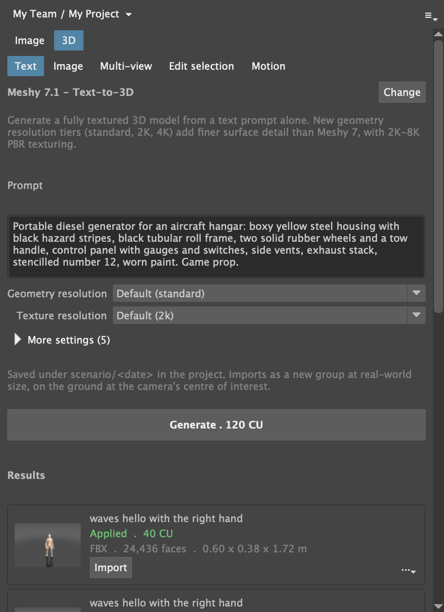

### The panel

Open it with **Scenario > Scenario Panel**. It docks beside the Channel Box
and comes back with your workspace layout. From top to bottom:

- **Workspace**: the team and project the panel works in (`My Team / My
  Project`). Click it to switch. Prices, uploads, results and the job list
  belong to that project.
- **Tabs**: **Image** and **3D**. The 3D tab has five modes: **Text**,
  **Image**, **Multi-view**, **Edit selection** and **Motion**. A tab opens on
  the mode you used last in it.
- **The mode**: its model, with **Change** to pick another; the inputs the
  mode needs (an image, views, a mesh, a character); the prompt, which hides
  when the model takes none; the model's settings, read from Scenario; and the
  **Generate** button with its price. Ctrl+Enter presses it.
- **Results**: one card per job of this mode, with its status, its price and
  the actions valid now (Import, and Apply... for an edit; Card, Material or
  Image plane for an image; Retry download). Before the first result, example
  prompts to start from. The **...** menu of a card has Show file, Open on
  Scenario, Re-run settings (fills the form with that job's settings, sends
  nothing) and Copy details.
- **Jobs**: every job of the project, from every Maya session (see
  [Jobs and recovery](#jobs-and-recovery)).

The **☰** button at the top right has Workspace..., Refresh jobs, Copy
diagnostics, the handbook, Privacy, Report a problem and Sign out.

### The Scenario menu

Maya's main menu bar gets a **Scenario** menu: Scenario Panel, Jobs, Import
GLB... (any GLB, no sign-in needed), Workspace..., Sign In... or Sign Out, and
Help (Handbook, Privacy, Report a Problem, Copy Diagnostics, About).

### Sign in

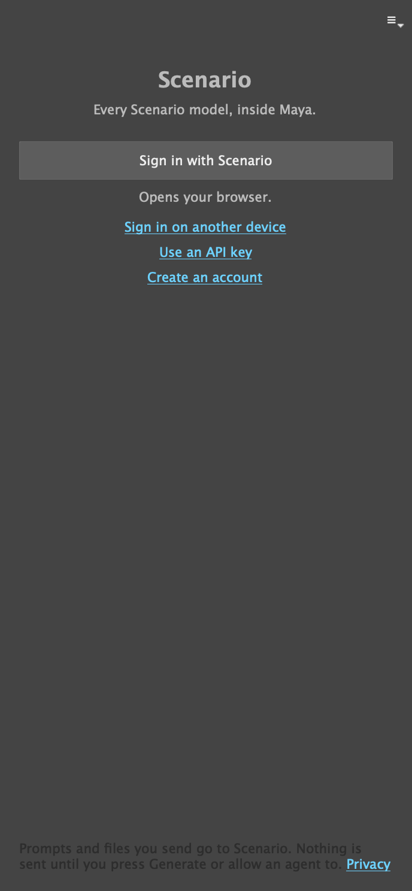

- **Sign in with Scenario**: your browser opens on Scenario's sign-in page,
  you approve, and Maya picks up the session.
- **Sign in on another device**: the panel shows a code to enter on any
  device, for a machine without a browser.
- **Use an API key**: a key and its secret from your project's API keys on
  [app.scenario.com](https://app.scenario.com).

Secrets go to the system's credential store (macOS Keychain, Windows
Credential Manager or Secret Service), never to the scene or Maya's
preferences. Nothing is sent to Scenario until you sign in.

 

## 3D from a prompt

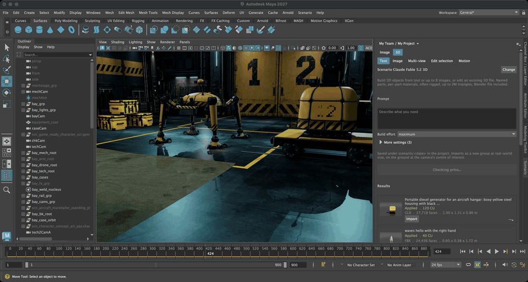

*Recorded in Maya 2027.2 on a live Scenario model; the wait is sped up.
[Video](media/flow-3d.mp4).*

### Generate

| 1. Priced before sending | 2. Followed on Scenario | 3. Imported and checked |
| --- | --- | --- |
|  | 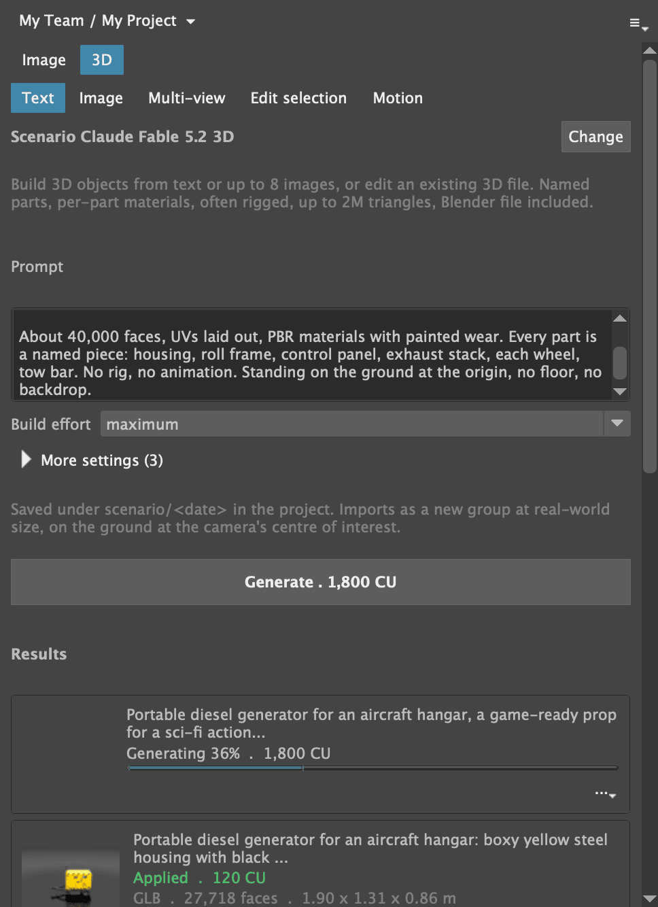 | 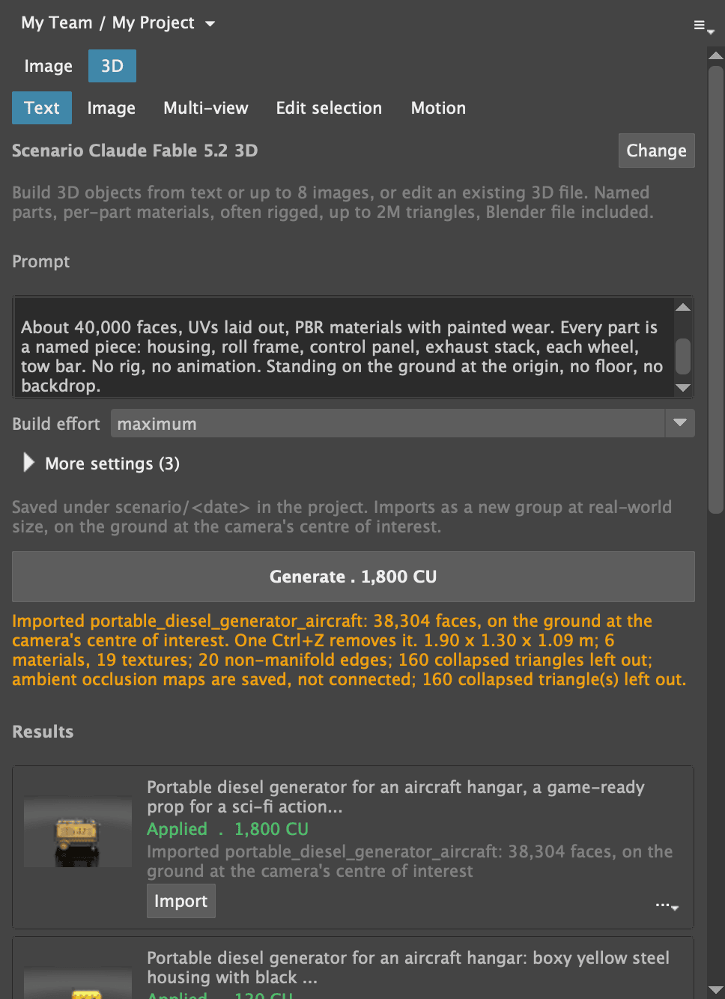 |

1. Open the **3D** tab, **Text** mode, and pick the model with **Change**.
   Scenario Claude Fable 5.2 3D builds a full asset: named parts, a material
   per part, and a rig and a clip when the prompt asks for them. The default,
   Meshy 7.1 Text-to-3D, returns one textured 30,000-face mesh in about two
   minutes for 120 CU.
2. Describe one object: what it is, its size, its parts. The button shows
   the exact price once Scenario has checked it.
3. **Generate** sends the request once. The card follows the job and shows
   what came back: format, faces, size in metres and a preview.

*This run: a portable diesel generator, about 50 minutes at maximum build
effort: 38,304 faces in 12 named parts, 1.90 x 1.30 x 1.09 m, 1,800 CU.*

### Import

**Import** adds the model as a new group at the size Scenario returns, on the
ground below the camera's centre of interest, with OpenPBR materials and
textures in `sourceimages/scenario/`. The card reports the import checks:
size, materials and textures, non-manifold edges, missing textures. One
Ctrl+Z removes the whole import.

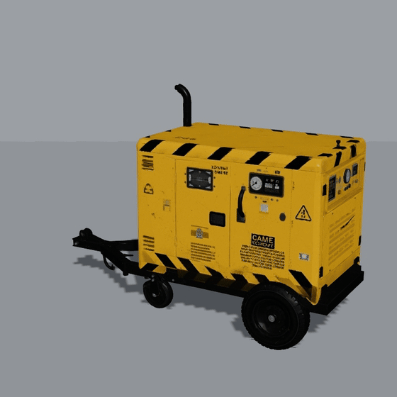

As imported: 12 named parts, 6 materials, 19 textures. <a href="media/turntable.mp4">MP4</a>

### A character from a prompt

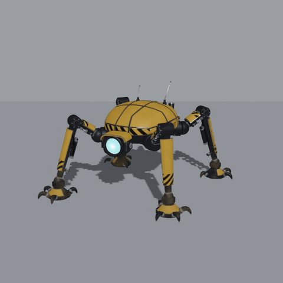

*The scout mech of this scene, from one prompt with the same model: 60 named
parts, 15 joints and a walk clip.*

### Import any GLB

**Scenario > Import GLB...** imports any local GLB the same way, without
signing in: meshes with UVs and normals, PBR materials, joints, skins, blend
shapes and the first animation clip.

## 3D from an image

| The image | The model, imported in Maya | Its clip |
| --- | --- | --- |
| 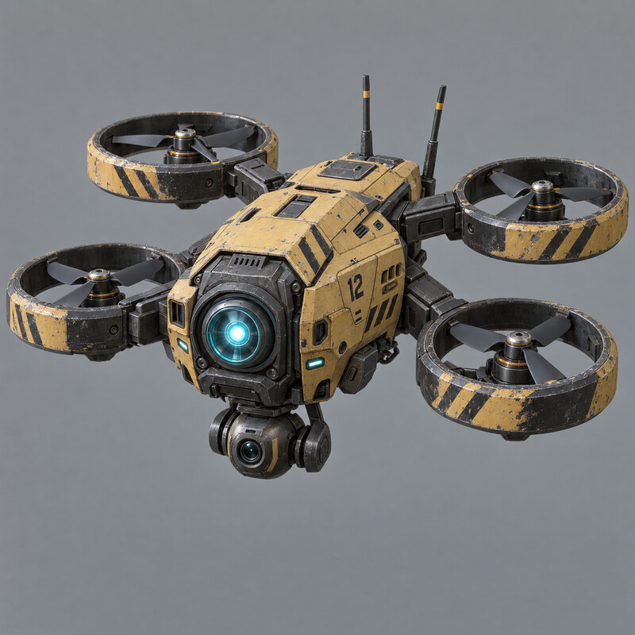 | 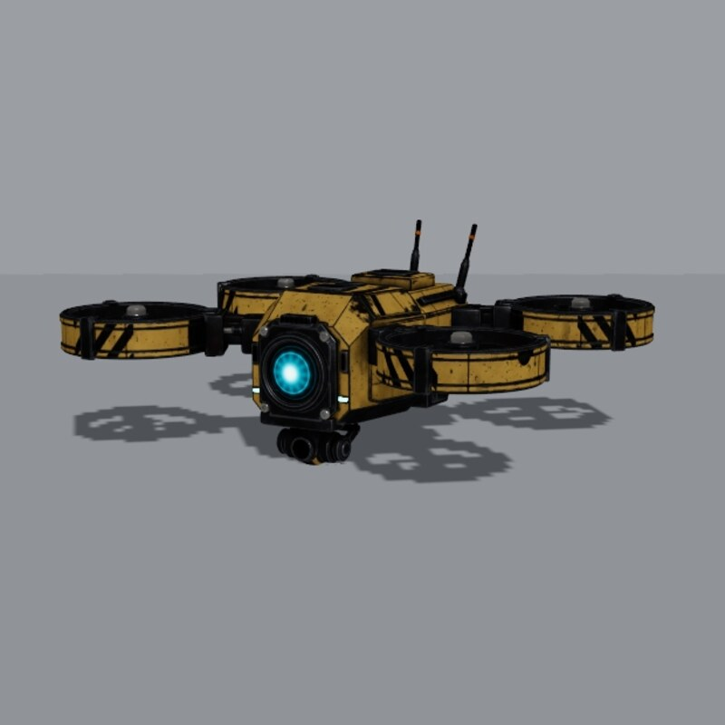 | 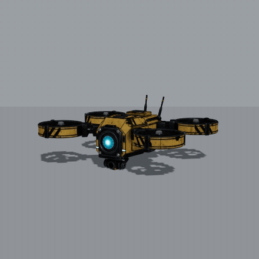 |

*Image: GPT Image 2.5 Sunburst, made in the Image tab. Model: Scenario Claude
Fable 5.2 3D, picked with **Change**, at maximum build effort: 38,000
triangles, 13 named parts, 10 joints and a 4-second hover clip. 2,100 CU.*

### Add the image

1. Open the **3D** tab and choose the **Image** mode.
2. Add the image: **File...** (PNG, JPEG or WebP), **Viewport** (a capture of
   the view you look through, grid and selection highlight hidden, so a
   blockout or a quick paint-over can be the start) or **Image results**
   (anything made in the Image tab).
3. The price shows on **Generate**; the card then follows the job and offers
   **Import**, as for a prompt.

A file or a capture is sent to your Scenario project when you add it, once
per session. One clear image of one object on a plain background works best.

### From a blockout

**Viewport** sends the view you look through: block the shape out with cubes
and cylinders, frame it, and the model follows its proportions and pose.

| The blockout, captured from the viewport | The model | Its clip |
| --- | --- | --- |
| 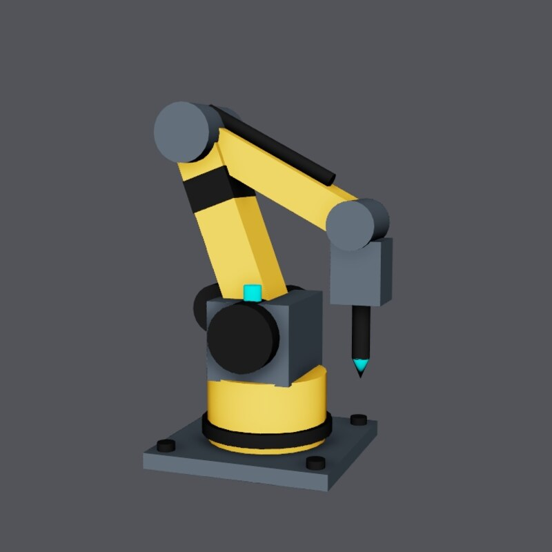 | 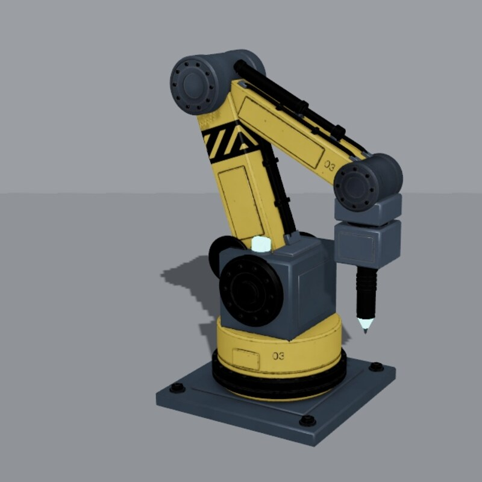 | 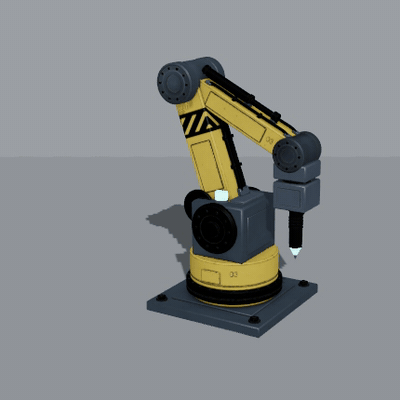 |

*Scenario Claude Fable 5.2 3D, from one viewport capture and a prompt: 28,816
triangles, 9 named parts, 6 joints and a 6-second weld clip. 2,100 CU.*

### Which model

Scenario Claude Fable 5.2 3D builds a full asset from text or up to eight
images: named parts, a material per part, and a rig and a clip when the
prompt asks for them. The two quick picks return one textured mesh. From the
drone image above, one run each:

| | Meshy 7.1 Image to 3D, the default | Tripo P2 |
| --- | --- | --- |
| Front and back | 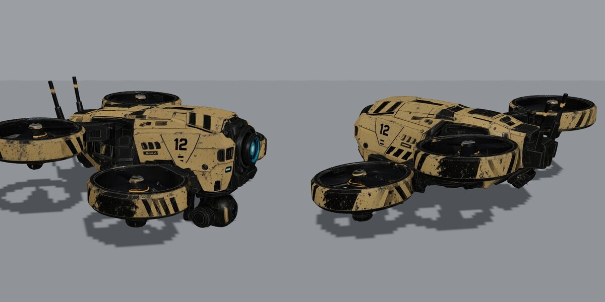 | 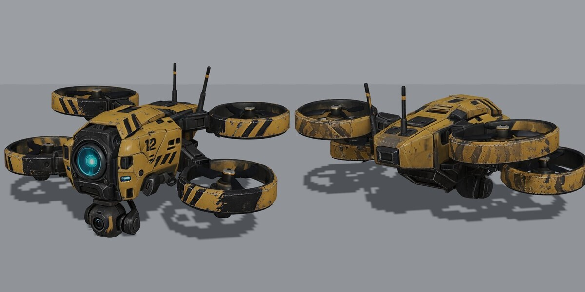 |
| Faces | 61,019 (4K settings, 60,000-face target) | 49,341 (50,000 face limit, extreme texture quality) |
| Look | Lighter paint, a clean stencil | Darker paint, more wear |
| Lands | Turned and tilted, like the picture | Level and facing front |
| Price | 140 CU, up to four views | 260 CU, one image |

## 3D from views of an object

The **Multi-view** mode builds a model from pictures of one object taken from
named sides. Select a blockout, a kitbash or an old asset: the plug-in
photographs it from the front, left, back and right, and the textured result
lands over it, facing the same way.

| | Front, left, back, right |
| --- | --- |
| Captured around a blockout | 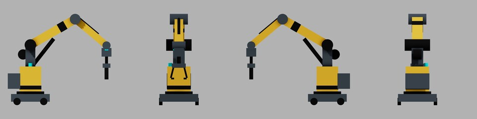 |
| Tripo P2 Multi View, the default | 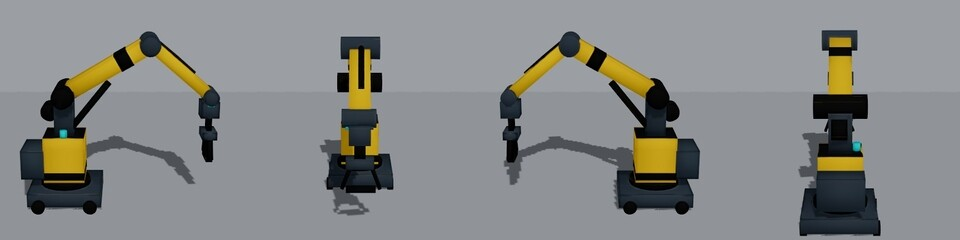 |
| Tripo 3.1 Multi View | 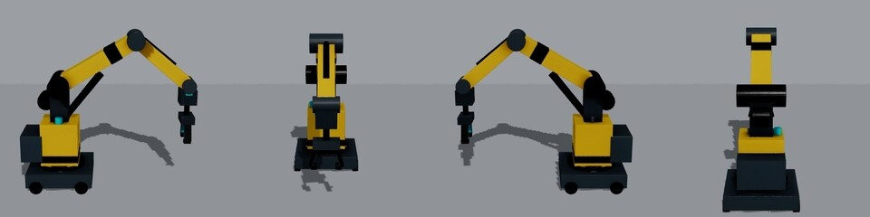 |

### Capture the views

1. Open the **3D** tab and choose **Multi-view**. Each view has a slot:
   Front, Left, Back and Right for the Tripo models; Hunyuan 3D Pro 3.1 adds
   Top, Bottom and the two front three-quarter views.
2. Select one object and press **Capture views**. It is rendered from each
   side at one scale, without the floor or its neighbours. Nothing is added
   to the scene or to the undo queue, and render settings are put back.
3. Model your blockout facing +Z: Left is the object's own left.
4. A slot also takes a file or an Image result, from its menu. The Tripo
   models need the front and at least one more view; **Generate** says what
   is missing, then shows the price.

### Where the result lands

**Import** places the result over the object its views came from, at its size
and facing the same way, as a new group. Your object is not changed. Views
added as files land like any 3D result, on the ground in front of the camera.

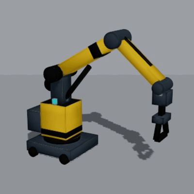 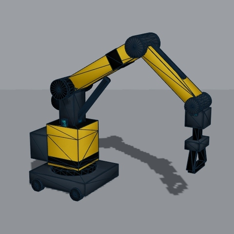

*One Tripo P2 run on the four views of a crane blocked out from cubes and
cylinders.*

### Which model

Same four views, one run each:

| Model | Faces | GLB | Price |
| --- | --- | --- | --- |
| Tripo P2 Multi View, the default | 4,822, a clean low-poly mesh | 1.8 MB | 240 CU |
| Tripo 3.1 Multi View, the low-cost choice | 1,466,572, dense | 44 MB | 45 CU |
| Hunyuan 3D Pro 3.1 Multiview | starts at 40,000, its lightest setting | not run yet | 120 CU |

Both Tripo results kept the shape and colours on every side and landed on
the blockout within three centimetres of its 4.25 m height.

## Quad meshes and FBX results

Scenario Claude Fable 5.2 3D and the Tripo models can return a mesh in quads,
as an FBX file: **Topology** and **Output format** under More settings for
Fable, the **quad** setting for Tripo. The plug-in imports the file through
Maya's own FBX importer, as one Ctrl+Z, and lands it like a GLB.

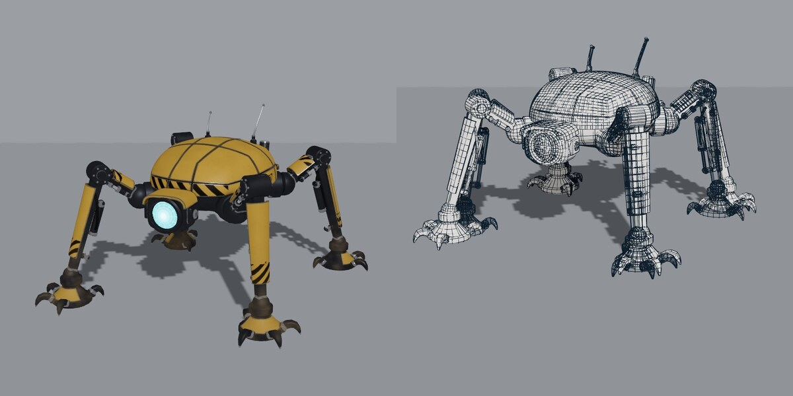

*The scout mech of this scene, built from a prompt with Scenario Claude Fable
5.2 3D (face budget 30,000, quads, FBX): 14,932 faces, all quads, in 60 named
parts with 15 joints.*

### What the plug-in does around the FBX importer

- Keeps the scene's unit, up axis, frame rate, playback range and current
  frame, which the importer would change.
- Imports even when the scene already has nodes of the same names, and
  cleans up the names the FBX format mangles.
- Keeps the importer's materials, with colour textures in sRGB and the other
  maps Raw, and writes the textures under `sourceimages/scenario/`.
- Lands a rigged character upright and in one piece, in a Y-up or a Z-up
  scene, its clip on the scene's start frame.

## Edit a mesh of the scene

The **Edit selection** mode sends one of your meshes to an edit model and
brings the result back: over the mesh as a new object, or onto the mesh
itself.

### What came back

A grey equipment case of 2,336 triangles, one run per model. The retexture
prompt: sand-yellow painted metal, a band of black hazard stripes, worn
edges.

| Your mesh | Meshy 7 Retexture | Tripo 3.0 Texturing |
| --- | --- | --- |
| 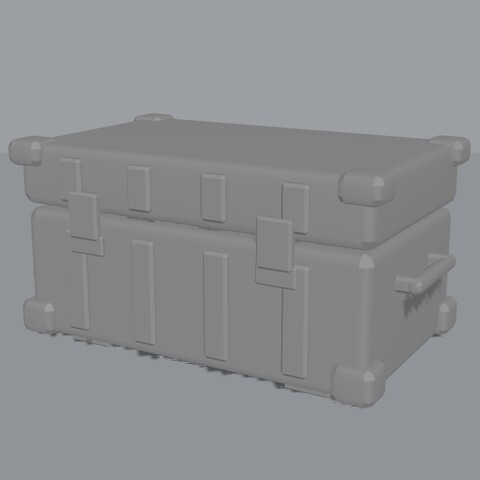 | 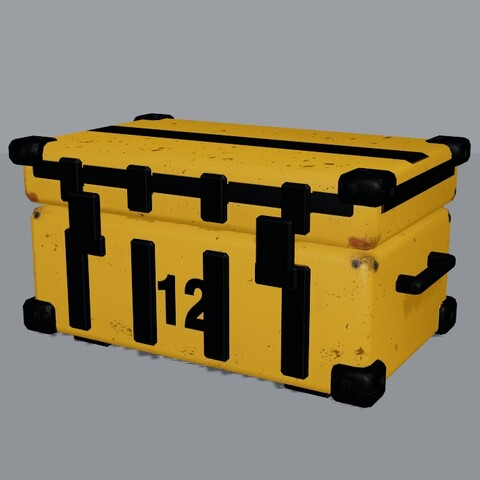 | 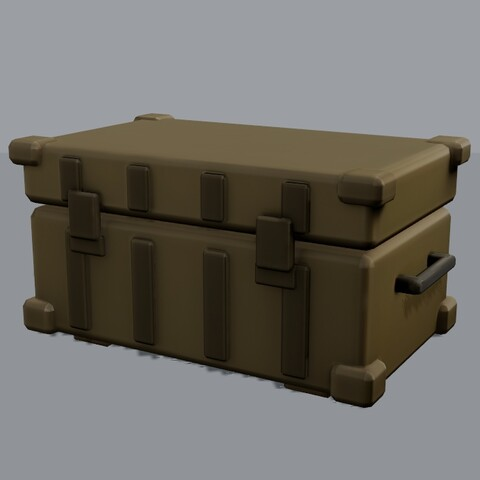 |
| 2,336 triangles | Same triangles and UVs. Base colour, normal, metallic and roughness maps. 40 CU | Same triangles and UVs. PBR textures at the detailed quality. 30 CU |

| Your UVs, on a checker | Tripo Smart UV |
| --- | --- |
| 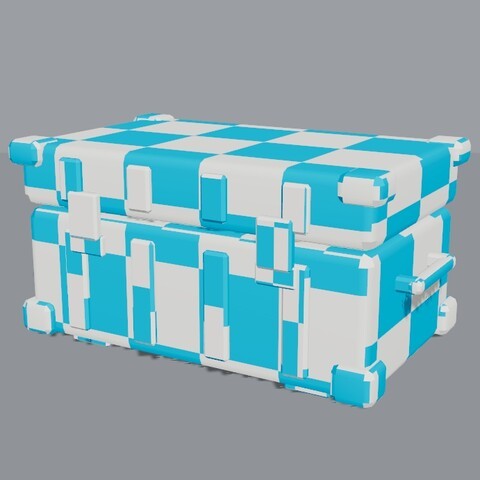 | 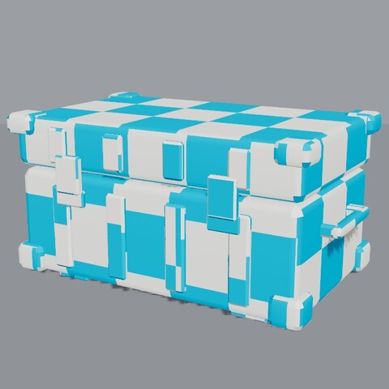 |
| The layout the mesh came with | A new layout on the same triangles. 40 CU |

| What was sent | Meshy Remesh | Tripo Retopology v3 |
| --- | --- | --- |
| 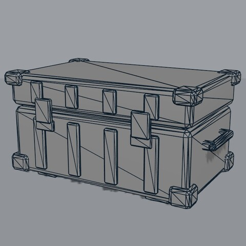 | 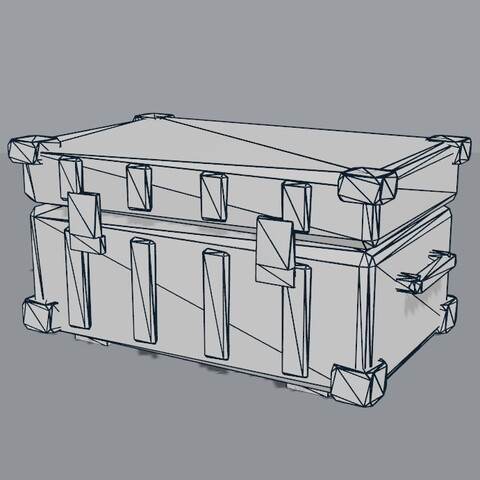 | 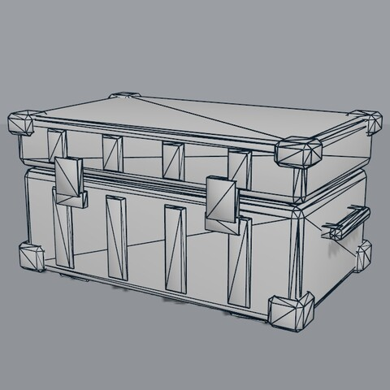 |
| 2,336 triangles (1,184 faces in Maya) | 1,212 triangles for a target of 1,200. New UVs, base colour and metal-roughness maps baked. 20 CU | 1,128 triangles for a face limit of 1,200. New UVs and a baked normal map. 70 CU |

### Send a mesh

1. Select one mesh (the object, or some of its faces) and open **3D**,
   **Edit selection**.
2. Choose the task: **Remesh**, **UV unwrap** or **Retexture**. Each task
   keeps its own model; the defaults are Tripo Retopology v3, Tripo Smart UV
   and Meshy 7 Retexture.
3. Press **Use selection**. The mesh is written with its UVs and base colour
   textures, then checked against the model's limit (Tripo Smart UV takes up
   to 80,000 triangles, Meshy UV Unwrap 44,000, Hunyuan UV Unwrapping
   30,000); a mesh the model cannot take shows why and is not sent. Object,
   scene and path names stay on your machine.
4. Retexture needs a prompt. The price shows on **Generate**.

### Import over the mesh

**Import** places the result over the mesh it came from, as a new group, even
if you moved the mesh after sending it. Your mesh is not changed. Most edit
models return the mesh resized and centred: the plug-in fits the result back
onto your mesh and checks that both are the same shape. A result that is not
still lands, and the import message says so.

### Apply onto the mesh

**Apply...** writes the result onto the mesh itself. The plug-in first checks
that the result is the same surface as your mesh (for a remesh, the same
shape), then a review lists what changes and what is kept. One Ctrl+Z undoes
the whole apply.

| Task | What Apply changes | What it keeps |
| --- | --- | --- |
| UV unwrap | The current UV set gets the result's UVs | The old layout as `<set>_scnPrev`, geometry, other UV sets, materials |
| Retexture | A new material from the result's maps is assigned to the mesh; UVs too if the model changed them | The old material, unassigned; Maya's default material is never edited |
| Remesh | The shape is replaced by the result's mesh, under your transform and name, with the result's material when it has textures | The transform and its connections; the old shape, hidden, as `<shape>_scnPrev` with its history |

- Apply asks before deleting the mesh's construction history, which would
  overwrite new UVs, and before giving one material to a mesh that has
  several.
- It refuses deformed (skinned), referenced and locked meshes in this
  version, and a remesh refuses instanced ones. **Import** still works on
  them.

## Animate a character

The **Motion** mode turns a prompt into a character that moves: a skinned
mesh, its joints and a clip, imported as one Ctrl+Z. Some models bring their
own character; others rig and animate yours.

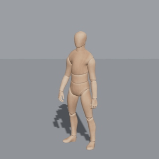 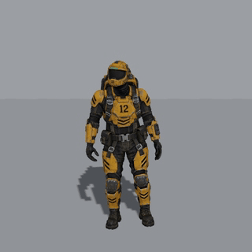

*"waves hello with the right hand". Left, from the prompt alone: 52 joints,
5 seconds. Right, a technician of 293,068 triangles sent from Maya: rigged
with 52 joints and animated for 4 seconds.*

### From a prompt alone

Open the **3D** tab and choose **Motion**. The default model, Meshy Text to
Motion, needs only the prompt. One simple action works best (a walk, a wave,
a jump): 2 to 10 seconds, 40 CU whatever the length.

### On your own character

1. Press **Change** and pick Uthana Text to Motion 3.0 or Cartwheel Text to
   Motion. Cartwheel needs a character; Uthana takes one or makes its own.
2. Select the character (its group or its meshes) and press **Use
   selection**. It is sent to your project once, as one GLB with neutral
   names. Nothing is added to the scene or to the undo queue.
3. **Import** lands the result over your character, at its size. Your
   character is not changed.

Model the character standing, facing front (+Z), arms away from the body,
and check which way a rig faces before animating further. On the technician,
both Uthana's and Cartwheel's rigs faced front.

### Frame rate and timeline

The clip starts on the scene's start frame; the playback range is not
changed. A model's frame-rate setting starts at the scene's rate when the
model offers it (Uthana: 24, 30 or 60 fps). A clip made at another rate has
keys between frames, and the result says so.

### Which model

One prompt, one run each:

| Model | Character | Result | Price |
| --- | --- | --- | --- |
| Meshy Text to Motion, the default | Its own wooden mannequin (52 joints) | FBX; a full arm wave, then back to rest | 40 CU, 2 to 10 s |
| Uthana Text to Motion 3.0, first pick for your character | Yours (auto-rigged, 52 joints) or its own (160 joints) | GLB; the hand comes up beside the head and waves | 104 CU for 4 s; 124 CU with a character |
| Cartwheel Text to Motion | Yours, required (52 joints) | Maya FBX; a smaller wave at chest height | 192 CU for 8 s |

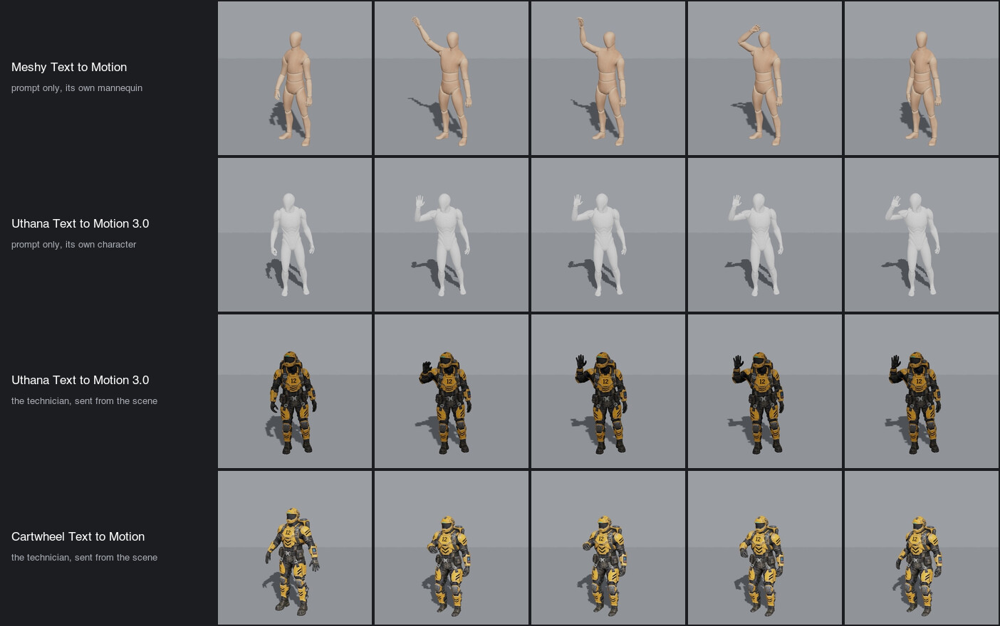

## Generate an image

| Ready | As a card facing the camera | As a material on a selected mesh |
| --- | --- | --- |
| 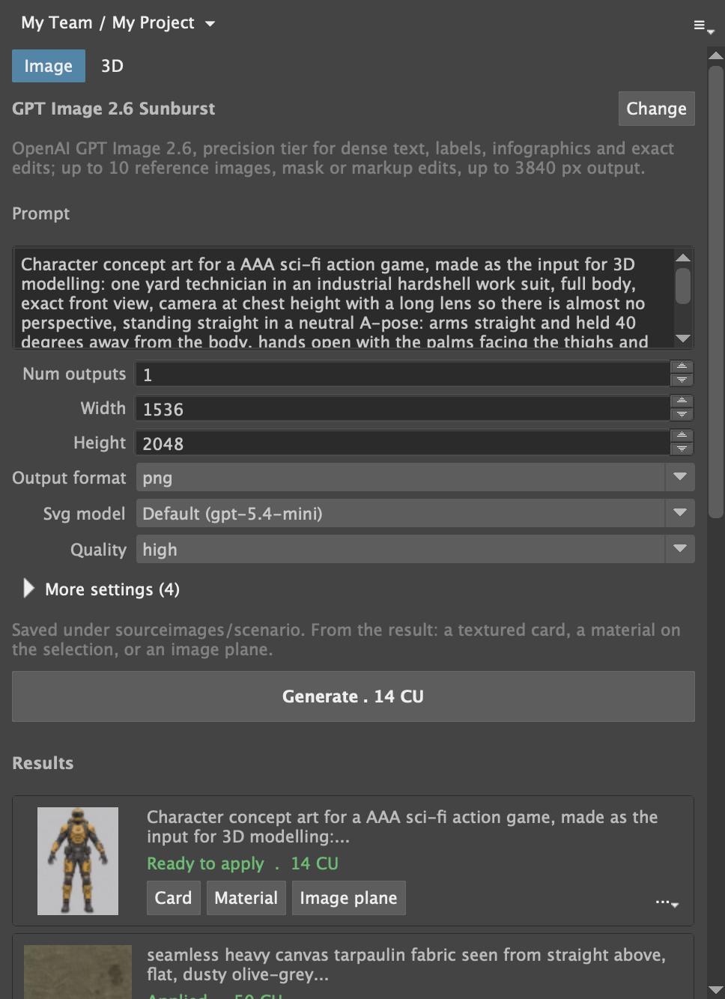 | 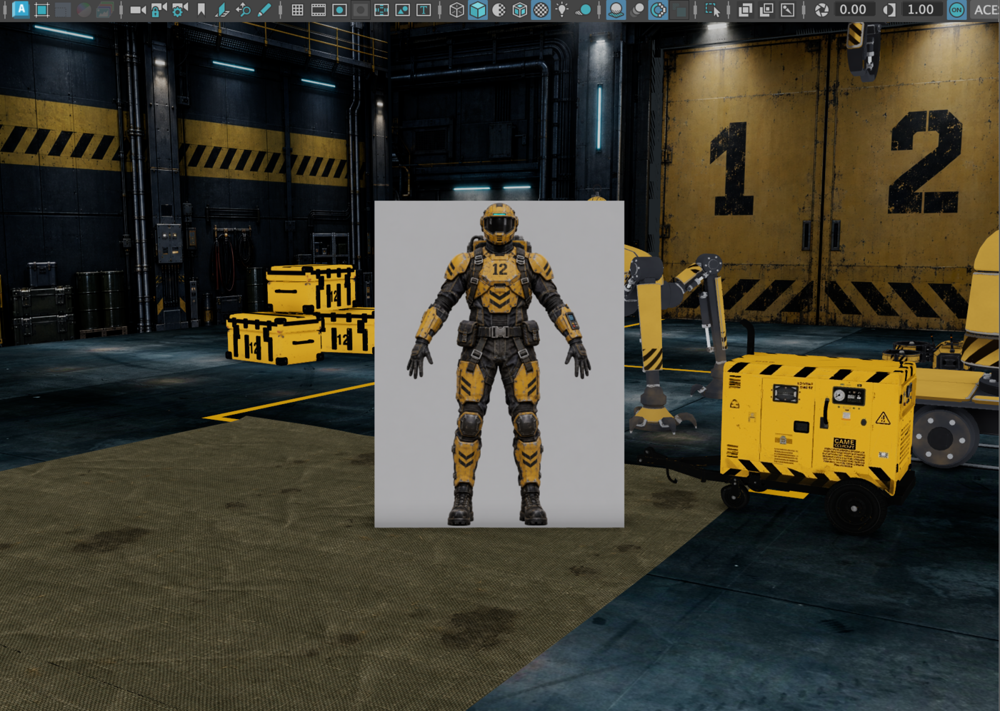 | 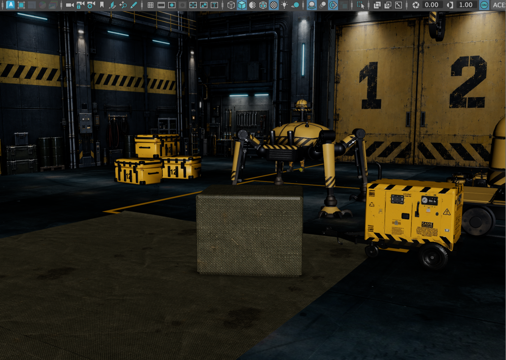 |

### Land it in the scene

The **Image** tab prices and generates like the 3D tab (default model: GPT
Image 2.5 Flare; the pictures above use GPT Image 2.6 Sunburst, picked with
**Change**). A ready image lands three ways, each one Ctrl+Z:

- **Card**: a textured plane facing the camera, at its centre of interest. Use
  it as a reference board next to your model.
- **Material**: base colour of a new material on the selected meshes or faces.
- **Image plane**: on the current camera, to model or animate against.

Files go to `sourceimages/scenario/`.

### Turn it into a 3D model

**Make a 3D model from this image**, in a result's **...** menu, opens 3D,
Image with the image in place: concept, then mesh, without leaving Maya.

## Choose a model

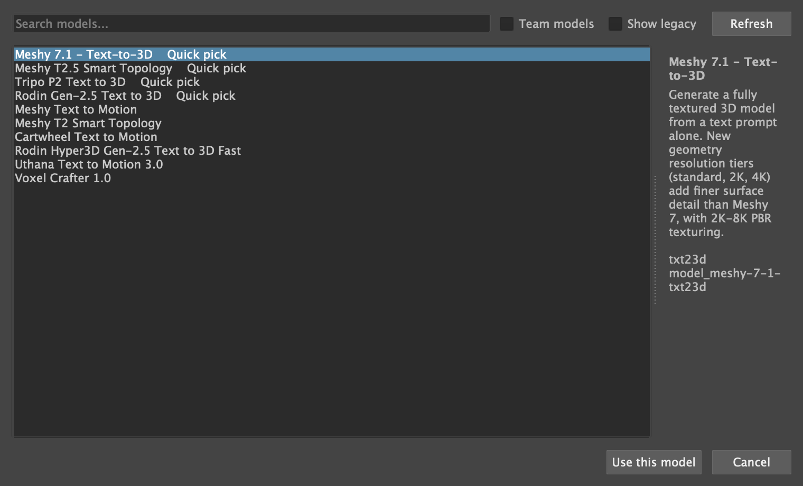

**Change** opens the picker for the current mode: the mode's quick picks
first, the ones this guide compares, then the other models of that kind in
Scenario's catalog, with search, a **Team models** filter for your team's
own models, and **Show legacy** for older models. The settings below the
prompt follow the model you pick, read from Scenario.

## Prices and spending

### The price on the button

Every request is priced before it is sent. When you edit the prompt or a
setting, the panel asks Scenario for the price, a free check, and the button
shows it: `Generate . 120 CU`. **Price unavailable (Retry)** means the check
failed; nothing was spent.

### What the plug-in guarantees

- A price is valid for the exact request it was checked for, for two
  minutes. Any edit asks for a new price.
- The job is saved on your computer before the request is sent, and it is
  sent once. If Maya crashes or the connection drops while it is being sent,
  the job shows as **Not confirmed** (see below) rather than being sent again.
- The plug-in sets no spending cap of its own. Your team's limits on Scenario
  apply.

## Jobs and recovery

### The job list

**Jobs**, at the bottom of the panel or in the Scenario menu, lists every job
of the project from every Maya session, newest first: state, model, prompt or
input, quoted and charged CU. Right-click a job for **Copy details** (local
and Scenario job ids, prices, times, the error and its hint), for a support
request.

A job goes through Preparing, Submitting, Queued, Starting, Generating (with
a percentage when Scenario reports one), Finalizing, Finished and
Downloading to Ready to apply, then Applied once it is in the scene. It can
also end as Failed, Blocked (refused by Scenario's content rules), Download
failed, Canceled or Not confirmed.

### When Maya closes

Jobs live on Scenario, not in Maya. Close Maya during a long generation and,
at the next start, the panel offers the results that finished meanwhile:
press **Download**. A download that stopped resumes from where it was, with a
fresh link; **Retry download** on the card does the same by hand. If Scenario
cannot be read several times in a row, delivery pauses and the card says why.

### Not confirmed

A job is **Not confirmed** when Maya stopped, or the connection dropped,
while its paid request was being sent: Scenario may or may not have received
it, and may have charged it. Maya warns at the next start. To protect you
from paying twice, the plug-in blocks the identical request (same project,
model and settings). Check your project's jobs on
[app.scenario.com](https://app.scenario.com) before generating it again.
Changing anything in the request sends a new one.

## Files and folders

Results go into the current Maya project (**File > Set Project**), so they
travel with your scene:

- **3D results**: `scenario/<date>/<name>/` in the project, the GLB or FBX
  with a `scenario.json` record of how it was made.
- **Images, and the textures of 3D results**: `sourceimages/scenario/<name>/`.
- **Captures, views and the meshes sent for an edit**:
  `images/scenario/captures/`.

Results are also in your Scenario project, so you find them again on
[app.scenario.com](https://app.scenario.com).

Every node the plug-in creates carries its provenance (model, prompt, price,
job and asset ids) as attributes, so the scene opens on machines
without the plug-in and anyone can tell where an asset came from. Anyone you
send the scene to can read those prompts.

The plug-in's own files (settings, the job list, the model catalog cache and
logs) are in `scenario/` inside Maya's user folder (`Documents/maya` on Windows,
`~/Library/Preferences/Autodesk/maya` on macOS, `~/maya` on Linux).

## Troubleshooting

### Sign-in

- **The browser does not come back to Maya**: use **Sign in on another
  device** and type the code, or an API key.
- **"Unlock the login keychain"** (macOS): the Keychain is locked; unlock it
  and sign in again.
- **"Sign in again or check the API key"**: the session expired or the key
  was revoked.

### Prices and requests

- **Price unavailable**: press it to retry. A request the model refuses (a
  missing input, a value out of range) shows Scenario's reason.
- **"Upgrade the plan or wait for the limit to reset"**: your team's plan or
  limit refused the request; nothing was spent.
- **"Paid requests from Maya cannot name a task yet"**: the project bills
  every request to a task; choose another project.
- **"Mesh not accepted by this model"**: too many triangles for the edit
  model; reduce the mesh or pick another model.

### Network

- **A certificate error behind a company proxy**: the proxy inspects TLS; its
  root certificate must be in the system's trust store, which the plug-in
  uses.
- **Download failed**: press **Retry download**; it resumes.

### Reporting a problem

**Scenario > Help > Copy Diagnostics** copies versions, paths and state,
never a secret, to paste into a [GitHub issue](https://github.com/scenario-labs/maya-plugin/issues)
with the job's **Copy details**. Or write to support@scenario.com.

## Known limits

- Agents: a local Scenario MCP server inside Maya, so Claude Code, Codex or
  Cursor can drive the same actions, is not built yet.
- 3D: rigging without a motion, splitting into parts, putting a motion onto a
  rig already in the scene (retargeting, HumanIK), video to motion.
- Images: editing, upscale, LoRAs.
- Other kinds of result: materials, sky domes, video, audio.
- A settings page, a history of past results, and a list of the Scenario
  assets in the open scene.
- Linking a Not confirmed job to a Scenario job from the panel.
- Tested on Maya 2027.2 on macOS. Maya 2025 and 2026, Windows and Linux are
  supported but not yet checked by hand; the Multi-view, Edit selection and
  Motion modes were checked in automated runs of Maya, not by hand.
